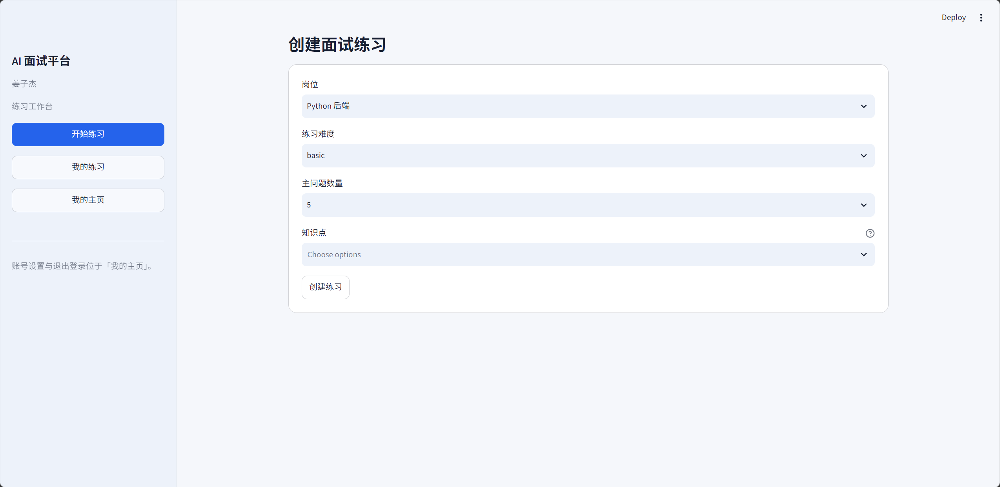
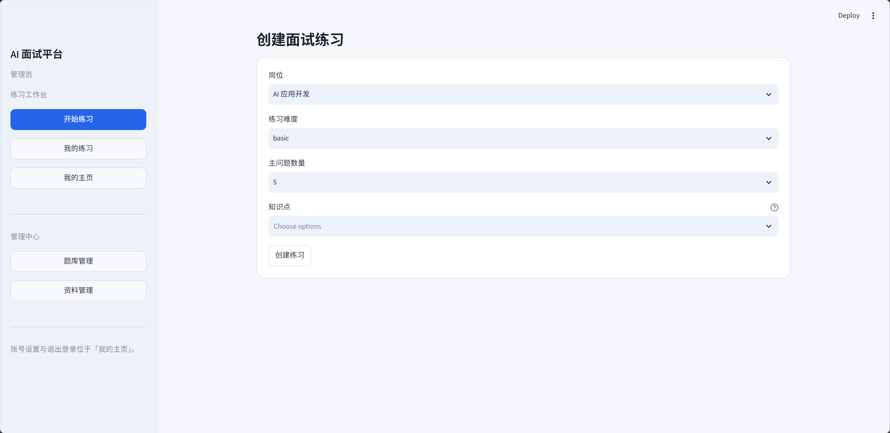
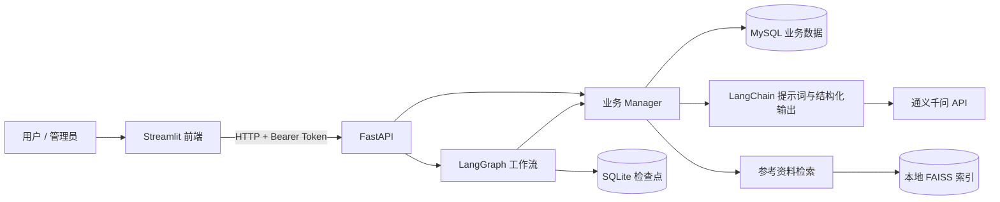
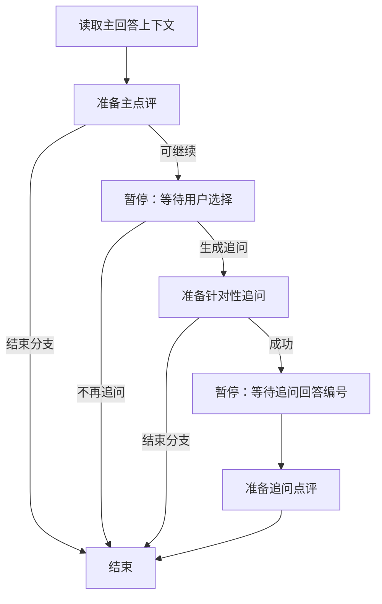

# AI 面试练习平台

基于 Python 的文字面试练习项目，覆盖 **选题练习 → 提交回答 → AI 点评 → 针对性追问 → 练习报告**，支持管理员维护题库和 RAG 参考资料。

项目用于学习 Python 前后端开发、FastAPI、异步数据库操作、LangChain、LangGraph 和 RAG。前端使用 Streamlit，后端使用 FastAPI，通过兼容 OpenAI 的接口调用通义千问。

> 当前为本地运行的学习项目。本文以现有代码为准，需求文档中的规划不代表全部已经实现。

## 目录

- [功能与界面](#功能与界面)
- [技术栈](#技术栈)
- [业务流程](#业务流程)
- [项目结构](#项目结构)
- [本地运行](#本地运行)
- [初始化题库与资料](#初始化题库与资料)
- [使用方式](#使用方式)
- [常见问题](#常见问题)
- [数据与使用说明](#数据与使用说明)

## 功能与界面

### 用户功能

- 注册、登录、查看个人信息和修改昵称，使用 JWT 验证身份。
- 按岗位、难度和知识点创建练习，主问题数量可选 3、5、10 道。
- 点击题号自由切换，逐题提交回答，查看历史练习。
- AI 点评包含正确之处、遗漏要点、错误解释和改进建议；依据不足时明确提示。
- 每道主问题最多生成一次针对性追问，提交追问回答后获得独立点评。
- 练习结束后生成总结报告，包括整体表现、薄弱点、追问表现和学习建议。

### 管理员功能

- 题目新增、编辑、筛选、详情查看、审核和停用。
- JSON 批量导入题目，逐条反馈导入结果。
- 资料新增、编辑、审核、停用和 Markdown/TXT 文件导入。
- 切分预览、重建向量索引、检索参考片段及来源。

### 界面展示

#### 用户主界面

用户通过侧栏进入开始练习、历史练习与个人主页。



#### 管理员主界面

管理员通过管理中心维护题库、导入资料并管理检索索引。



## 技术栈

| 技术 | 用途 |
| --- | --- |
| Python、Streamlit | 页面、表单、侧栏导航与页面会话状态 |
| FastAPI、Pydantic | HTTP 接口、请求校验、依赖注入和接口文档 |
| SQLAlchemy、aiomysql、MySQL | 异步访问与保存业务数据 |
| JWT、pwdlib | 登录凭证验证和密码哈希 |
| LangChain | 提示词模板、模型调用和结构化输出 |
| LangGraph | 单题流程、条件分支、暂停与恢复 |
| SQLite checkpointer | 本地保存 LangGraph 执行检查点 |
| Embedding、FAISS | 资料向量化与相似片段检索 |
| HTTPX | Streamlit 向 FastAPI 发送 HTTP 请求 |

## 业务流程

### 前后端协作



前端通过 URL 调用接口，不直接访问数据库。后端验证身份、检查练习归属、读取数据、调用模型并保存结果。`services` 中的 Manager 负责业务编排和数据库读写，生成服务负责组织提示词与调用模型。

### 单题工作流



共享状态记录用户、练习、回答编号和业务阶段。节点调用对应 Manager，条件边决定后续路径。用户选择和回答到达后，后端使用相同 `thread_id` 恢复流程。检查点记录执行进度，MySQL 保存正式问答与点评，两者用途不同。

### RAG 辅助点评

1. 管理员将资料正文和来源保存到 MySQL，检查后设为 `approved`。
2. 重建索引读取已审核资料，按约 800 字符切分，配置 100 字符重叠。
3. 调用 Embedding API 生成向量，将 FAISS 索引和片段信息保存到本地。
4. 生成主点评前，根据题目检索片段，过滤距离过大、已停用或修订号不一致的片段。
5. 将题目、参考要点、回答与片段一起交给模型，保存点评及本次提供的参考资料。

检索失败时，主点评可退回题目和参考要点继续生成，并显示提示。候选片段不等于模型实际引用的全部证据，也不保证点评完全正确。当前 RAG 主要接入主问题点评，并非所有 AI 功能都各自执行资料检索。

## 项目结构

```text
AI_Interview/
├── backend/
│   ├── main.py                 # FastAPI 入口、接口与权限校验
│   ├── database.py             # 异步引擎、会话与 Base
│   ├── llm.py                  # 聊天与 Embedding 客户端
│   ├── init_admin.py           # 将已有账号设置为管理员
│   ├── models/                 # SQLAlchemy 数据表映射
│   ├── schemas/                # Pydantic 请求和结果定义
│   ├── services/               # 点评、追问、报告、切分与检索
│   └── workflows/              # LangGraph 状态、节点与图
├── frontend/
│   ├── app.py                  # 登录、导航与个人主页
│   ├── ui.py                   # 公共样式和展示名称
│   ├── interview.py            # 练习、历史问答和 AI 结果
│   ├── question_admin.py       # 题库管理
│   └── document_admin.py       # 资料管理、文件导入与检索
├── data/
│   ├── questions_example.json  # 示例题库
│   └── documents/              # Markdown 资料与导入说明
├── images/                     # README 截图
├── .streamlit/config.toml      # 前端主题
├── runtime/                    # 本机生成，不提交 Git
│   ├── interview_checkpoints.sqlite
│   └── knowledge_index/        # index.faiss、index.pkl、config.json
├── .env                        # 本机配置，不提交 Git
├── AI_Interview_Requirements.md
└── README.md
```

## 本地运行

以下以 **Windows PowerShell + Conda** 为例。当前未提供 Docker 配置和锁定版本的依赖清单。

### 1. 获取项目与创建环境

```powershell
git clone https://github.com/jiangzijie88-ops/AI_Interview.git
cd AI_Interview
conda create -n aiinterview python=3.11 -y
conda activate aiinterview
```

后续命令均在项目根目录执行。已下载项目或创建环境时，直接进入目录并激活环境。

### 2. 安装依赖

```powershell
python -m pip install fastapi "uvicorn[standard]" streamlit httpx sqlalchemy aiomysql cryptography python-dotenv "pwdlib[argon2]" PyJWT pydantic langchain-openai langchain-community langchain-text-splitters langgraph langgraph-checkpoint-sqlite aiosqlite faiss-cpu
```

命令根据代码使用的包整理，未锁定版本，尚未在全新环境重装验证。不同依赖版本可能需要调整，请使用独立环境。

### 3. 配置 `.env`

在根目录新建 `.env`，填写自己的配置：

```dotenv
DB_HOST=127.0.0.1
DB_PORT=3306
DB_USER=root
DB_PASSWORD=替换为你的数据库密码
DB_NAME=ai_interview
JWT_SECRET_KEY=替换为随机生成的长密钥
DASHSCOPE_API_KEY=替换为你自己的API密钥
LLM_BASE_URL=替换为百炼当前地域的OpenAI兼容接口地址
LLM_MODEL=替换为你已开通的聊天模型名称
EMBEDDING_MODEL=替换为你已开通的向量模型名称
```

中文内容均为占位值，必须替换。接口地址、Key 和模型需匹配服务地域，确认账号具有相应模型调用权限。

生成随机 JWT 密钥：

```powershell
python -c "import secrets; print(secrets.token_hex(32))"
```

前端默认访问 `http://127.0.0.1:8000`。如需更改，在启动前端的终端设置 `$env:API_URL = "你的后端地址"`；前端不会自行读取根目录 `.env` 中的这个变量。

### 4. 首次创建数据库与表

先启动 MySQL 服务，通过 SQLTools、MySQL Workbench 等工具连接并执行：

```sql
CREATE DATABASE IF NOT EXISTS ai_interview CHARACTER SET utf8mb4;
```

库名需与 `.env` 的 `DB_NAME` 一致。SQLTools 用于人工管理，后端会根据 `.env` 自行连接。

后端启动不会自动建业务表，仓库也没有完整的建表 SQL 文件。**首次使用空数据库**时，可在 PowerShell 执行以下一次性命令，导入全部模型并创建表：

```powershell
@'
import asyncio
import importlib
import pkgutil
import backend.models
from backend.database import Base, async_engine

# 导入全部模型，让 Base 收集数据表定义。
for module in pkgutil.iter_modules(backend.models.__path__):
    importlib.import_module(f"backend.models.{module.name}")

async def main():
    try:
        async with async_engine.begin() as connection:
            await connection.run_sync(Base.metadata.create_all)
    finally:
        await async_engine.dispose()

asyncio.run(main())
'@ | python -
```

这只创建缺失的表，不会迁移已有表结构；升级旧数据库需另行核对字段。已有完整数据库的开发者无需执行。

### 5. 启动后端

```powershell
conda activate aiinterview
python -m uvicorn backend.main:app --reload
```

| 地址 | 用途 |
| --- | --- |
| <http://127.0.0.1:8000/docs> | 查看和调试接口 |
| <http://127.0.0.1:8000/health> | 检查后端服务 |
| <http://127.0.0.1:8000/health/db> | 检查 MySQL 连接 |

### 6. 启动前端

在项目根目录另开一个终端：

```powershell
conda activate aiinterview
python -m streamlit run frontend/app.py
```

浏览器打开 <http://localhost:8501>。两个终端均需保持运行，按 `Ctrl+C` 停止对应服务。

### 7. 创建管理员

先在前端注册账号，再执行：

```powershell
conda activate aiinterview
python -m backend.init_admin
```

按提示输入刚注册的用户名。该命令提升已有账号的角色，不创建默认账号或默认密码。重新登录后可进入管理中心。

## 初始化题库与资料

### 准备分类

示例题库使用数字 ID 关联分类。下面约定与示例文件对应，适用于新建的空数据库；已有数据应先检查编号，必要时调整 JSON，避免关联错误。

```sql
USE ai_interview;

INSERT INTO job_roles (id, name) VALUES
(1, 'Python 后端'),
(2, 'AI 应用开发');

INSERT INTO knowledge_points (id, name) VALUES
(1, 'Python 基础'),
(2, 'SQL 与 MySQL'),
(3, 'FastAPI'),
(4, 'Streamlit'),
(5, 'LangChain'),
(6, 'LangGraph'),
(7, 'Agent 开发'),
(8, 'RAG');
```

仅用于首次初始化，不需要重复执行。名称可调整，但示例题库中的编号必须对应。

### 导入并审核题目

1. 管理员登录，进入「题库管理 → 批量导入」。
2. 选择 `data/questions_example.json`，点击「开始导入」。
3. 查看逐条结果，修正失败项后再导入。重复导入会重复新增，避免直接重传整份文件。
4. 进入「浏览与维护 → 详情与审核」，检查内容并审核需要使用的题目。
5. 创建练习只使用 `approved` 题目，草稿数量不等于可用数量。

示例文件当前有 72 道题，覆盖 Python、FastAPI、数据库、Streamlit、LangChain、LangGraph、Agent 和 RAG。主问题来自题库，追问由模型根据当前问答生成。

### 导入参考资料与建立索引

1. 参考 [`data/documents/00_资料目录与导入说明.md`](data/documents/00_资料目录与导入说明.md) 选择资料。
2. 进入「资料管理 → 新增与导入」，展开「新增参考资料」。
3. 选择 UTF-8 编码的 `.md` 或 `.txt` 文件，填写标题、来源链接和版本说明，再保存草稿。文件内容优先于正文输入框。
4. 单个文件不超过 1 MB，正文不超过 10000 个字符，过长时按主题拆分。
5. 在「资料列表」选择资料，检查后审核通过。
6. 进入「索引与检索」，展开资料索引，点击「重建资料索引」。
7. 用资料覆盖的问题试检索，确认片段和来源合理。

`data/documents` 文件不会自动入库。资料新增、修改、状态变化，或更换 Embedding 模型后应重建索引。无关问题返回 0 个片段是允许的结果。

## 使用方式

普通用户从「开始练习」配置岗位、难度、题数和知识点。多个知识点按匹配其中任意一个筛选，不选表示不限制。创建后点击题号切换并逐题提交。

提交后可生成主点评，按需进入一次追问。草稿在当前页面会话中暂存，刷新或关闭浏览器后不保证保留；正式提交数据保存到 MySQL。

完成后在「我的练习」打开历史记录，查看问答与点评，并生成或读取总结报告。有未作答题时结束练习需要确认。个人信息、改昵称、退出登录位于「我的主页」。

管理员从侧栏进入题库和资料管理。题目编辑后需重新审核，资料变更后应重建索引，使检索内容与当前版本一致。

## 常见问题

| 现象 | 优先检查 |
| --- | --- |
| `No module named uvicorn` 等缺包错误 | 是否激活正确环境，使用对应 `python -m pip install ...` |
| 无法导入 `backend.main` | 是否位于根目录；启动参数为 `backend.main:app`，不是斜杠路径 |
| `Unknown database` / 数据表不存在 | 先创建数据库和表，检查 `.env` 库名 |
| 缺少环境变量 | 根目录 `.env` 是否存在、变量名是否一致 |
| 题目不足 | 检查筛选条件和审核状态，减少题数或调整条件 |
| `/docs` 提示 401 | 登录取得 token，在 Authorize 中按 Bearer 提示填入 token |
| 管理功能提示 403 | 是否通过初始化命令设置管理员 |
| 模型调用失败 | 检查 Key、接口地址、模型权限、网络和额度，查看后端日志 |
| 资料检索不可用 | 是否有已审核资料，是否建索引，Embedding 模型是否一致 |
| 检索为 0 | 可能无相关内容，或资料停用、版本变化，按需重建 |
| 主题未生效 | 重启 Streamlit 并刷新浏览器 |

## 数据与使用说明

- **MySQL**：账号、分类、题库、练习快照、回答、点评、追问、报告和资料正文。
- **`runtime/interview_checkpoints.sqlite`**：工作流检查点，用于暂停和恢复。
- **`runtime/knowledge_index/`**：本机 FAISS 索引、片段数据和模型配置。
- **`data/`**：随仓库分享的题库和资料源文件，不包含实际练习记录。

`.env`、`runtime/`、SQLTools 临时查询和个人总结已由 `.gitignore` 忽略。提交前仍应检查暂存区，避免上传密码、密钥和私人数据。仅加载本项目自行生成且可信的本地索引。

点评、追问、报告、向量化和检索会调用外部 API，可能产生费用，对应问答或资料会发送给模型服务。演示时使用不含隐私的数据。

当前面向单进程、本地学习与演示，未提供 Docker 一键部署、自动迁移、生产部署和完整自动化测试方案。AI 输出需人工判断，不能作为正式招聘评估结论。薄弱点独立复习、简历/JD 定制不属于当前已完成的功能；报告中的薄弱点总结不等于独立复习模块。

资料主要为官方文档的学习归纳，来源和版本见各文件，转载时应核对原始资料许可。仓库当前未附开源许可证，不应默认具有特定开源授权。
