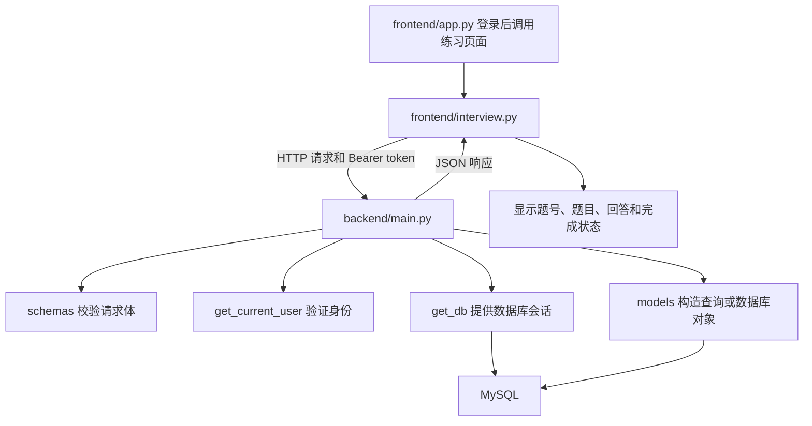
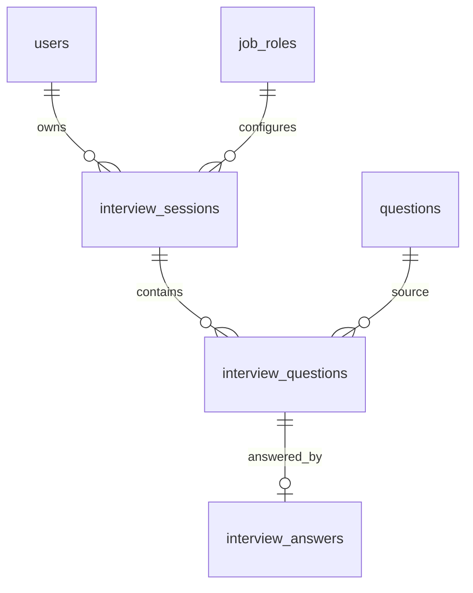

# 会话管理模块代码与业务逻辑总结

整理日期：2026-11-04。本文依据当前工作区代码，采用已经调整好的“点击题号自由作答”方案。

本文用于学习复盘，不是新的实现方案。文中代码片段用于解释；附录保存了整理时的后端相关源码，后续修改项目后，本文不会自动同步。

## 1. 先理解：这个模块解决什么问题

会话管理中的“会话”，就是用户的一次面试练习。例如：“用户选择 Python 后端、基础难度、3 道题，完成一次练习”。

当前流程：

```text
登录
 → 选择岗位、难度、题数和知识点
 → 创建练习并固定本次题目
 → 查看自己的练习列表
 → 打开练习，点击题号自由切换
 → 每道题分别填写、提交
 → 查看已保存的回答
 → 完成本次练习
```

核心业务规则：

- 可以先回答第 3 题，再回答第 1 题，不要求顺序作答。
- 点击题号只切换显示，不等于提交，也不等于放弃某道题。
- 每道题当前只有“未作答 / 已回答”两种作答状态，不再使用 skip。
- 正式提交的回答不能修改；相同请求的重试不会重复插入回答。
- 全部答完后结束，状态为 `completed`。
- 有未作答题时，用户明确确认后也可以结束，状态为 `ended_early`。
- 完成按钮不会自动提交输入框中的草稿。
- 创建练习、回答提交、结束练习都需要登录，并检查练习归属。

目前没有接入 AI 点评、模型追问、LangChain、LangGraph 或报告生成。“会话基础作答流程已实现”不等于整个 AI 面试项目完成。

## 2. 文件夹和文件分工

```text
项目根目录/
├─ backend/
│  ├─ main.py                         # FastAPI 接口、身份验证、核心业务
│  ├─ database.py                     # 数据库引擎、数据库会话、ORM 基类
│  ├─ models/
│  │  ├─ interview_sessions.py         # 一次练习
│  │  ├─ interview_questions.py        # 本次练习中的题目快照
│  │  ├─ interview_answers.py          # 正式回答
│  │  ├─ users.py                     # 用户，供身份及练习归属使用
│  │  ├─ job_roles.py                 # 岗位，供创建配置使用
│  │  ├─ knowledge_points.py          # 知识点，供筛选使用
│  │  ├─ questions.py                 # 公共题库及关联表，供抽题使用
│  │  └─ __init__.py                  # 包文件，目前没有额外业务
│  └─ schemas/
│     ├─ interview_sessions.py        # 创建、完成、旧提前结束的请求格式
│     ├─ interview_answers.py         # 回答提交的请求格式
│     └─ __init__.py                  # 包文件
├─ frontend/
│  ├─ app.py                          # 登录和页面入口
│  └─ interview.py                    # 创建、列表、题号、草稿、回答、完成
├─ .env                               # 本地数据库等配置，不应提交密钥
├─ AI Interview 本地数据库.session.sql # 手动执行 SQL 的工作文件
├─ AI_Interview_Requirements.md        # 项目需求；部分原始顺序练习描述已被后续决定调整
├─ README.md                          # 启动命令
└─ 总结/
   └─ 会话管理模块代码与业务逻辑总结.md
```

四层职责要分清：

| 层次 | 文件位置 | 负责什么 | 不负责什么 |
|---|---|---|---|
| 页面 | `frontend/interview.py` | 收集输入、发送请求、显示结果 | 不直接操作 MySQL |
| 请求格式 | `backend/schemas/` | 检查类型、范围、必填项 | 不查询岗位是否真实存在 |
| 业务接口 | `backend/main.py` | 身份、归属、规则、查询和保存 | 不负责 Streamlit 页面布局 |
| 数据映射 | `backend/models/` | 表名、字段、外键、唯一约束 | 定义类本身不会自动建表 |

数据库通过 SQLTools 手动建表，当前没有使用 Alembic 或自动建表逻辑。

## 3. 总体调用关系



这不是 Python 从前端直接调用后端函数。前端使用 `httpx` 发送 HTTP 请求，FastAPI 根据地址选择函数，再将结果转换成 JSON。

Streamlit 是 Python 写的页面；当前 `httpx` 请求由 Streamlit 服务进程发出。浏览器主要负责展示和输入。

## 4. 最容易混淆的名词和变量

| 名称 | 示例 | 含义 |
|---|---|---|
| 用户编号 `user_id` | 2 | 谁在练习 |
| 练习编号 `session_id` | 3 | 哪次练习 |
| 公共题目编号 `question_id` | 12 | 题库里的哪道原始题 |
| 快照编号 `question_record_id` | 7 | 本次练习中的哪道题目副本 |
| 题号 `position` | 1 | 在本次练习中排第几题 |
| 练习版本 `revision` | 4 | 这次练习的业务状态版本 |
| 提交编号 `submission_id` | UUID 字符串 | 同一次回答提交的唯一标识 |
| 后端 `session` | `InterviewSession` 对象 | 数据库中的一条面试练习记录 |
| 后端 `db` | `AsyncSession` 对象 | 用于查询和提交数据库操作的工具 |
| 前端 `st.session_state` | 字典式状态容器 | 当前 Streamlit 页面会话中的临时状态 |

例如：“用户 2 的练习 3 中，第 1 题的快照编号是 7，来源题库编号是 12”。这些数字不需要相等。

后端请求参数 `data` 通常是 Pydantic 对象，使用 `data.revision`；前端 `response.json()` 得到的是字典，使用 `data["revision"]`。同名变量不代表同一种类型。

## 5. 数据库三张核心表及其关系



一条练习通常包含 3、5 或 10 条题目快照；每个快照最多有一条正式回答。

### 5.1 `models/interview_sessions.py`：一次练习

```python
class InterviewSession(Base):
    __tablename__ = "interview_sessions"
```

`Base` 来自 `database.py`，表示这个类属于 SQLAlchemy ORM 模型体系。`__tablename__` 指定数据库表名。

| 字段 | 业务作用 |
|---|---|
| `id` | 练习自身的主键 |
| `user_id` | 外键指向 `users.id`，记录练习归属 |
| `job_role_id` | 外键指向 `job_roles.id`，记录岗位 |
| `difficulty` | 基础或进阶 |
| `question_count` | 创建时安排的总题数 |
| `current_position` | 旧顺序作答方案的兼容字段，新页面不依赖它 |
| `status` | `in_progress`、`completed`、`ended_early` |
| `config_snapshot` | 创建时配置的 JSON 副本 |
| `revision` | 状态变更的版本号 |
| `started_at` | 创建时间 |
| `ended_at` | 结束时间，进行中通常为空 |

例如 `Mapped[int]` 是属性类型提示，`mapped_column(...)` 配置数据库列；`nullable=False` 不允许为空，`primary_key=True` 表示主键。

当前状态转换：

```text
in_progress
 ├─ 全部已答后调用 /finish → completed
 ├─ 有未答题并确认 /finish → ended_early
 └─ 调用保留的旧 /end     → ended_early
```

`completed` 表示作答流程结束，不表示所有题答对。现在还没有 AI 评分。

### 5.2 `models/interview_questions.py`：题目快照

模型名是 `QuestionRecord`，表名是 `interview_questions`。文件名与类名不完全一样是允许的，只要导入时使用实际类名。

| 字段 | 业务作用 |
|---|---|
| `id` | 快照自身编号 |
| `session_id` | 外键指向本次练习 |
| `question_id` | 外键指向来源公共题目 |
| `position` | 固定题号 |
| `question_revision` | 创建时原题的修订号 |
| `content` | 复制后的题目正文 |
| `reference_points` | 复制后的参考要点 |
| `common_mistakes` | 复制后的常见错误 |
| `followup_direction` | 复制后的追问方向 |
| `sources` | 复制后的来源信息 |
| `knowledge_points_snapshot` | 当时题目关联知识点的 JSON 列表 |

关键约束：

```python
__table_args__ = (UniqueConstraint("session_id", "position"),)
```

同一次练习不能有两道“第 1 题”；不同练习都可以各有自己的第 1 题。末尾逗号使括号内容成为单元素元组。

### 5.3 快照究竟是什么

快照是“复制某个时刻的数据并保存”。它不是 SQLAlchemy 的特殊魔法。

例如今天创建练习时题目是“列表和元组的区别”，明天管理员将题库正文修改了，今天的练习仍然使用已经复制的正文。

当前有三种快照：

| 快照 | 保存位置 | 保存的是什么 |
|---|---|---|
| 配置快照 | `InterviewSession.config_snapshot` | 用户当时选择的岗位、难度、题数、筛选知识点 |
| 题目快照 | `QuestionRecord` 整行 | 本次安排的题目正文、参考要点等 |
| 知识点快照 | `QuestionRecord.knowledge_points_snapshot` | 这道题当时实际关联的全部知识点 |

配置中的知识点是用户的筛选条件，题目中的知识点快照是抽到的题实际关联的标签，两者不必相同。

外键只记录来源，复制后的字段才保存历史内容。只保存 `question_id`，以后每次都重新查公共题库，就不能保证历史内容不变。

### 5.4 `models/interview_answers.py`：正式回答

```python
question_record_id: Mapped[int] = mapped_column(
    ForeignKey("interview_questions.id"),
    nullable=False,
    unique=True,
)
```

方向是 `interview_answers.question_record_id → interview_questions.id`。

回答关联本次练习的快照，而不是公共题库编号。这样同一道公共题目出现在两次练习中，可以分别保存两次回答。

`unique=True` 限制一条快照最多有一条正式回答。`submission_id` 也有唯一约束，用于避免同一提交标识被重复使用。

其余字段为回答自身 `id`、原始正文 `content`、提交时间 `created_at`。没有单独保存用户编号，因为可以沿“回答 → 快照 → 练习 → 用户”找到归属。

回答表没有 `revision` 字段。当前使用的是练习表的 `revision`。

## 6. `backend/database.py`：数据库工具从哪里来

### 6.1 配置与引擎

文件通过 `Path(__file__).resolve().parent.parent` 找到根目录，用 `load_dotenv` 读取根目录 `.env`。

`URL.create(...)` 用环境变量构造连接配置，驱动是 `mysql+aiomysql`。报告不记录真实密码和 JWT 密钥。

`create_async_engine(...)` 管理数据库连接池；`pool_size=5` 不是应用启动就立即打开五条连接。`pool_pre_ping=True` 会在取出连接时检查有效性。

### 6.2 会话工厂与依赖

```python
AsyncSessionLocal = async_sessionmaker(
    bind=async_engine,
    expire_on_commit=False,
)
```

工厂用于创建数据库会话。`expire_on_commit=False` 使提交后仍可以直接读取已经加载的对象字段，便于构造返回结果。

```python
async def get_db():
    async with AsyncSessionLocal() as session:
        try:
            yield session
        except Exception:
            await session.rollback()
            raise
```

`yield` 暂时将数据库会话交给接口；请求结束后继续清理。异常时回滚尚未提交的修改；离开 `async with` 后关闭会话、释放资源。

这里没有成功后自动 `commit()`。需要保存的接口必须自行提交；GET 查询接口不需要为了读取而提交。

### 6.3 常用数据库操作

| 代码 | 含义 |
|---|---|
| `select(Model)` | 构造查询，不会仅因写这一行就执行 SQL |
| `.where(...)` | 添加筛选条件 |
| `await db.execute(statement)` | 执行语句，得到结果对象 |
| `result.scalar_one_or_none()` | 取一个对象或值，没有则为 `None` |
| `result.scalars().all()` | 取第一列的多个对象组成列表 |
| `result.all()` | 取全部结果行，适合查询题目和回答两个对象 |
| `await db.scalar(select(Model.id)...)` | 直接取一个编号，没有则为 `None` |
| `db.add(obj)` | 将新增对象交给会话管理，不需要 `await` |
| `await db.flush()` | 将待写入内容发送给数据库，可取得自增编号，但还未最终提交 |
| `await db.commit()` | 提交整个事务 |
| `await db.rollback()` | 撤销本次事务尚未提交的修改 |

数据库通信使用 `await`；普通赋值、字典操作、`db.add()` 不必因此加 `await`。异步不代表一段代码中的每一行都可以或都需要等待。

## 7. `backend/schemas/`：请求数据的入口检查

### 7.1 创建练习

`InterviewSessionCreate` 中：

```python
job_role_id: int = Field(gt=0)
difficulty: Literal["basic", "advanced"] = "basic"
question_count: Literal[3, 5, 10] = 5
knowledge_point_ids: list[int] = Field(default_factory=list)
```

`gt` 表示大于，`ge` 表示大于等于；`Literal` 限定可选值。`default_factory=list` 在没有传知识点时生成一个新的空列表。

岗位编号 999 可能通过类型检查，但数据库未必存在岗位 999，接口还要实际查询。

### 7.2 提交回答

`InterviewAnswerCreate`：

- `question_record_id`：正整数快照编号。
- `submission_id`：合法 UUID，Pydantic 会把输入字符串解析成 UUID 对象，接口再用 `str(...)` 保存。
- `revision`：大于等于 1 的练习版本。
- `content`：1～1000 字符。

```python
if not value.strip():
    raise ValueError("回答不能为空")
return value
```

检查时临时使用去空白的结果，但最终返回原文，保留 Python 代码可能需要的换行和缩进。

### 7.3 完成练习

```python
class InterviewSessionFinish(BaseModel):
    revision: int = Field(ge=1)
    confirm_unanswered: bool = False
```

有未答题时需要明确确认。服务端会重新数回答，不接受前端自报的已答数量作为事实。

`InterviewSessionEnd` 目前仍为旧 `/end` 接口服务，新页面不调用它。`InterviewSessionNext` 和跳过 schema 已经删除。

## 8. `backend/main.py`：接口与业务逐个复盘

### 8.1 接口总表

| 方法 | 地址 | 函数 | 当前用途 |
|---|---|---|---|
| POST | `/interview_sessions` | `create_interview_session` | 创建练习，成功返回 201 |
| GET | `/interview_sessions` | `list_interview_sessions` | 查询自己的练习列表 |
| GET | `/interview_sessions/{session_id}/current?position=2` | `get_current_interview_question` | 查询指定题目和全部题号状态 |
| POST | `/interview_sessions/{session_id}/answers` | `submit_interview_answer` | 保存任意一道题的正式回答 |
| POST | `/interview_sessions/{session_id}/finish` | `finish_interview_session` | 新版页面统一完成入口 |
| POST | `/interview_sessions/{session_id}/end` | `end_interview_session` | 保留的旧提前结束入口，新页面不用 |

`tags` 只影响 `/docs` 分组，`summary` 是接口简短说明，不改变业务规则。

### 8.2 每个接口共有的身份与数据库依赖

```python
db: AsyncSession = Depends(get_db)
current_user: User = Depends(get_current_user)
```

FastAPI 自动调用依赖函数，把数据库工具和登录用户对象交给接口。

`get_current_user` 从 `Authorization: Bearer <token>` 提取 token，验证签名、过期时间和必要字段，将 `sub` 转为用户编号，再查询用户是否存在。

接口使用：

```python
InterviewSession.id == session_id,
InterviewSession.user_id == current_user.id,
```

同时限定练习编号和登录身份。用户编号不由前端自由填写，因此改地址不能读取别人的练习。

### 8.3 创建练习：`create_interview_session`

流程：检查岗位 → 检查知识点 → 筛选题库 → 检查题量 → 按历史优先级抽题 → 保存练习及快照。

`point_ids = set(data.knowledge_point_ids)` 用集合去重。查询出的知识点编号集合必须与请求集合相同，否则有编号不存在。

`conditions` 保存多个条件：已审核 `approved`、指定难度、关联所选岗位。选择多个知识点时匹配任意一个；空列表表示不限制。

`.where(*conditions)` 中的 `*` 是将列表展开为多个参数，这些条件共同生效。

题量不足返回 400，提供 `available_count` 和 `required_count`；此时不创建半份练习。

`last_used` 子查询按当前用户、公共题目分组，取 `max(started_at)` 作为最近安排时间。外连接后，未安排过的题没有历史时间，MySQL 升序时 NULL 在前，因此优先未安排过的题，其次较早安排过的题，最后用 `func.rand()` 打散同优先级结果。

注意：这是“安排过”，不是“回答过”；创建后从未打开的题也会进入安排历史。

```python
db.add(session)
await db.flush()
```

先取得新练习的 `session.id`，再给题目快照写外键。

```python
for position, question in enumerate(questions, start=1):
```

`enumerate` 同时给出从 1 开始的序号和题目对象，固定本次题目顺序。`records` 列表暂存新建的快照对象，用于提交后返回第一道题。

创建配置时保存用户选的筛选知识点；创建题目快照时保存这道题全部关联的知识点，两者用途不同。

最后一次 `commit()` 保存练习和全部快照，不是每道题单独提交。正常情况下途中出错、未提交的数据会回滚。

创建返回第一道题作预览，正式自由选题在“我的练习”中打开。创建接口目前没有请求幂等标识，网络超时后应先查看练习列表，不能认定创建失败就立即再点一次。

### 8.4 练习列表：`list_interview_sessions`

查询始终限制当前用户；可传岗位和状态筛选。前端当前提供状态筛选，后端还支持岗位参数。

先 `count()` 统计总数，再查询当前页：

```python
.offset((page - 1) * page_size)
.limit(page_size)
```

例如第 2 页每页 10 条，就跳过前 10 条，取之后 10 条。按开始时间倒序，再按 ID 倒序保证同一时间下排序稳定。

岗位名称从 `config_snapshot` 读取，保留创建时名称。日期按 UTC 写入 MySQL `DATETIME`，返回列表时补 UTC 时区标记。

### 8.5 指定题目：`get_current_interview_question`

`position: int = Query(default=1, ge=1)` 是 URL 查询参数，例：`?position=3`；`session_id` 是路径参数。

旧地址保留 `/current`，但现在含义是“读取页面指定的题目”，不再依据数据库 `current_position` 选题。

```python
select(QuestionRecord, InterviewAnswer)
.outerjoin(InterviewAnswer,
           InterviewAnswer.question_record_id == QuestionRecord.id)
```

外连接保留尚未回答的题。结果示例：

```text
(第1题对象, None)
(第2题对象, 回答对象)
(第3题对象, None)
```

`rows = result.all()` 得到这些行；`next((row for row in rows if row[0].position == position), None)` 取匹配题号的一行，没有则为 None。

`question, answer = selected` 是解包，把两个对象分给两个变量。

返回 `questions` 列表用于画题号，`answered_count` 用于进度统计，`selected_position` 表示页面选择，`current_question` 和 `current_answer` 表示选中的题及回答。

`sum(a is not None for q, a in rows)` 用 True 为 1、False 为 0 的求和方式统计已答题。

这个接口不修改数据库，不增加版本，不返回参考要点。后端允许读取本人已结束练习中的题目和回答。2026-11-05 补充：前端现已允许打开所有状态的练习，点击题号查看历史题目和正式回答；结束的练习只读，不显示输入框、提交按钮和完成按钮。未答题显示“当时未提交回答”。

### 8.6 正式提交：`submit_interview_answer`

先锁定自己的练习，再确认提交的快照属于它。现在没有“必须等于 current_position”的限制。

检查已存在回答：

```python
if existing_answer.submission_id == submission_id and existing_answer.content == data.content:
    # 返回已有回答，replayed=True，不重复写入
```

网络重试时相同标识和相同内容直接成功返回；其他重复回答返回 409。这个检查在版本和结束状态检查之前，因此同一次已成功提交的精确重试，即使练习之后结束了，也能返回已有结果，但不会产生新写入。

首次保存仍要求练习进行中且版本一致：创建回答对象 → `db.add(answer)` → `session.revision += 1` → `await db.commit()`。

捕获 `IntegrityError` 时回滚并返回 409，用于唯一约束冲突。正式回答和版本更新在一个事务中保存。

### 8.7 完成练习：`finish_interview_session`

先锁定练习并校验身份、状态、版本，然后连接题目快照表统计本次练习的回答数。普通 `join` 适合数实际存在的回答；读取全部题号时的 `outerjoin` 则需要保留未答题。

```python
unanswered_count = session.question_count - answered_count
```

有未答题且 `confirm_unanswered=False` 时返回 409 和未作答数量，不修改状态。

全部已答设为 `completed`；确认留空结束设为 `ended_early`。记录结束时间，增加修订号并提交。不会插入空回答，不会替用户补交草稿。

结束后再次请求 `/finish` 会返回 409；若网络超时，前端应重新查询状态，而不是把超时等同于失败。

### 8.8 保留的旧结束入口：`end_interview_session`

`/end` 仍在源码和 `/docs` 中，直接将进行中的练习设为 `ended_early`，不要求所有题已答，也不使用 `confirm_unanswered`。

它是兼容保留，不是新版页面的调用路径；当前前端统一请求 `/finish`。不要误认为所有旧代码都已清理。后续若统一清理，应一起处理这个接口和 `InterviewSessionEnd`。

## 9. 为什么既有 revision 又有 submission_id

| 机制 | 解决的问题 | 示例 |
|---|---|---|
| `revision` | 本次修改是否依据过期的练习状态 | 别的页面已经提交过一题，当前页面版本落后 |
| `submission_id` | 同一次回答请求是否重复发送 | 保存成功但网络超时，用户重试 |
| `with_for_update()` | 多个写请求同时修改同一练习 | 提交回答与完成练习同时到达 |
| 数据库唯一约束 | 最后一层防止重复数据 | 同一快照插入第二条正式回答 |

版本示例：

| 操作 | 页面题号 | revision |
|---|---:|---:|
| 创建练习 | 1 | 1 |
| 点击第3题 | 3 | 1 |
| 提交第3题 | 3 | 2 |
| 点击第1题 | 1 | 2 |
| 提交第1题 | 1 | 3 |
| 确认剩余未答并结束 | 1 | 4 |

版本不是题号，也不是已答数量。读取和切换不增加版本；首次保存回答和结束练习增加版本；精确重试不增加版本。

所有修改接口锁住同一条练习记录，提交或回滚后释放锁。它串行处理同一练习的写操作，不表示整个系统只能一个人使用。

## 10. 前端：能看懂调用即可

### 10.1 `frontend/app.py`：入口

登录成功后保存 token，调用：

```python
show_interview_create(API_URL, st.session_state.token)
show_interview_list(API_URL, st.session_state.token)
```

普通登录用户可以练习，不要求管理员。`init_admin.py` 是管理员初始化工具，不属于本次作答调用链；题库维护需要管理员，但练习不需要。

### 10.2 `show_interview_create`：创建表单

先请求 `/job_roles` 和 `/knowledge_points` 作为选项，再通过 `st.form` 收集配置。

`httpx.post(..., json={...})` 会将 Python 字典转换成 JSON；`headers` 放 token，`timeout` 设置等待上限。成功 201 显示编号和第一题预览。

### 10.3 `show_interview_list`：查询与选择练习

状态筛选和页码在表单外，变化会触发重新运行和查询。后端结果用 `st.dataframe` 展示。

`sessions` 字典保存当前页全部状态的练习；选中编号后调用 `show_current_interview`。进行中的练习可以继续作答，已完成和提前结束的练习可以只读查看历史回答。选项文字同时显示练习状态。

`st.session_state.pop("interview_notice", None)` 取出并移除一次性提示，用于结束后重跑页面显示成功信息。

### 10.4 `show_current_interview`：读取与题号按钮

```python
position_key = f"interview_position_{session_id}"
params={"position": st.session_state[position_key]}
```

每次练习有自己的页面选题键，初始为 1。第一次打开不会从旧 `current_position` 恢复；同一页面会话内可以保留选择。

`response.json()` 将响应转为字典。`st.columns` 创建题号区域，`zip(columns, data["questions"])` 把一列与一个题号对应起来。

```python
st.session_state[position_key] = item["position"]
st.rerun()
```

点击后改变选择并重跑，再请求指定题目。按钮的 `key` 包含练习编号和快照编号，避免不同题控件混淆。当前选中按钮使用 `primary` 样式。

### 10.5 草稿、输入框与提交标识是三种状态

```python
answer_key = f"answer_{session_id}_{question['id']}"
draft_key = f"draft_{answer_key}"
widget_key = f"input_{answer_key}"
```

| 键 | 保存内容 |
|---|---|
| `answer_key` | 本次尝试的 submission_id 和 pending_content |
| `draft_key` | 尚未正式提交的文字 |
| `widget_key` | 当前输入框控件的值 |

`save_answer_draft(widget_key, draft_key)` 将输入框内容另存到草稿键。Streamlit 可能清理不再显示的控件，独立草稿使切回题目时能恢复内容。

`st.text_area` 的 `on_change` 指定回调，`args` 传入键名。当前回答输入不用 `st.form`，让输入离开焦点后能先触发回调再切题。输入框最多 1000 字符，与后端一致。

草稿只在页面会话内暂存，刷新、关页、重启服务后不保证恢复，数据库中也没有草稿表。

点击提交时若内容与上次尝试不同，则生成新 UUID；相同内容重试保留 UUID。`uuid4()` 生成标识，`str(...)` 将其转换成可以传 JSON 的字符串。

提交成功后 `st.rerun()` 重新读取后端，发现 `current_answer` 不为空，就显示回答并提前 `return`，不再显示编辑框。

### 10.6 完成确认

页面始终展示“完成本次练习”折叠区，不要求正在看最后一题。

有未答题时显示数量及勾选框；`disabled=bool(unanswered and not confirmed)` 禁用尚未确认的按钮。确认控件的 key 包含 revision，正式状态改变后不会沿用旧版本的确认。

服务端会再检查，因此勾选框是交互提示，不是唯一的规则保障。

### 10.7 同步前端与异步后端

当前前端函数是普通 `def`，使用同步 `httpx.get/post` 等待请求；后端数据库接口是 `async def`，使用异步数据库驱动。前后端是两个服务，前端不必因为后端异步就全部加 `async`。

## 11. 完整实例：练习3，先做第3题

假设练习 3 有三个快照：7、8、9，对应题号 1、2、3，版本为 1。

### 11.1 点击第3题

```http
GET /interview_sessions/3/current?position=3
Authorization: Bearer <登录token>
```

响应示例：

```json
{
  "id": 3,
  "status": "in_progress",
  "question_count": 3,
  "revision": 1,
  "selected_position": 3,
  "questions": [
    {"id": 7, "position": 1, "answered": false},
    {"id": 8, "position": 2, "answered": false},
    {"id": 9, "position": 3, "answered": false}
  ],
  "answered_count": 0,
  "current_question": {"id": 9, "position": 3, "content": "示例题目"},
  "current_answer": null
}
```

`null` 对应 Python 的 `None`；`false` 对应 `False`。没有提交，所以表中不增加记录，版本仍为 1。

### 11.2 提交第3题

```http
POST /interview_sessions/3/answers
```

```json
{
  "question_record_id": 9,
  "submission_id": "8719dd7f-2ef6-4a10-9f36-55d203835eb9",
  "revision": 1,
  "content": "我的第3题回答"
}
```

成功后回答表增加一条，练习版本变为 2。重新读取时第3题为已答，`answered_count=1`。原样重试返回 `replayed=true`，不会产生第二条回答。

### 11.3 还有两题未答但决定结束

```http
POST /interview_sessions/3/finish
```

```json
{
  "revision": 2,
  "confirm_unanswered": true
}
```

后端实际统计已答1题、未答2题，将状态设为 `ended_early`，版本变为3。不会给另外两题插入空回答，也不会保存页面中的未提交草稿。

上述编号、UUID、版本仅为示例，在 `/docs` 中验证时必须使用自己的实际数据，新提交使用新 UUID。

## 12. 从动作看数据库到底变了什么

| 用户动作 | 练习表 | 快照表 | 回答表 | 前端临时状态 |
|---|---|---|---|---|
| 创建练习 | 新增1条 | 新增3/5/10条 | 不变 | 显示创建结果 |
| 查询列表 | 不变 | 不变 | 不变 | 列表筛选和页码 |
| 点击题号 | 不变 | 不变 | 不变 | 修改所选 position |
| 输入草稿 | 不变 | 不变 | 不变 | 更新输入和草稿 |
| 首次提交某题 | revision加1 | 不变 | 新增1条 | 重跑，显示已答 |
| 精确重试同次提交 | 不变 | 不变 | 不变 | 显示已有成功结果 |
| 完成练习 | 修改状态、时间、版本 | 不变 | 不变 | 显示结束提示 |

## 13. 常见响应与阅读代码的方法

| 状态码 | 当前模块常见含义 |
|---|---|
| 200 | 查询、回答提交、完成成功 |
| 201 | 创建练习成功 |
| 400 | 创建配置对应的题量不足 |
| 401 | 未登录、token 失效 |
| 404 | 岗位、知识点、练习或指定题目不存在/不可访问 |
| 409 | 练习结束、版本过期、重复回答冲突、未答结束未确认等 |
| 422 | FastAPI/Pydantic 请求格式检查失败 |

当前回答提交中，提交不属于这次练习或不存在的快照返回409，这是现有代码行为；不要假设所有不存在对象都会统一返回404。

阅读每个函数时按四步问：输入从哪里来？检查什么？查或改哪张表？返回给前端什么？

## 14. 删除、兼容保留与尚未实现的内容

### 14.1 已删除

- `backend/models/interview_skips.py`。
- `backend/schemas/interview_skips.py`。
- `/skip` 接口、相关查询和限制。
- `/next` 接口和 `InterviewSessionNext`。
- 页面跳过按钮、强制顺序下一题按钮。
- MySQL `ai_interview.interview_skips` 表及其中旧记录。

### 14.2 仍保留的兼容内容

- `interview_sessions.current_position` 字段。
- 创建和列表响应中的部分 `current_position` 数据。
- 创建成功区域显示第一题预览。
- 旧 `/end` 接口及 `InterviewSessionEnd`，新版页面不调用。
- `/current` 地址名称虽然保留，实际读取题目由查询参数 position 决定。

**特别提醒：整理时，根目录 `AI Interview 本地数据库.session.sql` 仍保存旧 `CREATE TABLE ... interview_skips` 语句。SQL 文件是历史执行文本，不是数据库当前状态。表虽然已删除，重新执行这段旧建表 SQL 仍会把它建回来。本文仅记录这个现状，没有修改该 SQL 文件。**

### 14.3 当前边界

- 已提交回答不可编辑。
- 草稿未持久化到数据库。
- 当前所选题号未持久化到数据库，新页面会话默认从第1题显示。
- 已结束练习可按题号只读查看题目和正式回答，不能补答或修改；当前尚无 AI 点评或整场报告可展示。
- 创建请求尚无专门的重复请求标识。
- 全部题目和回答一次查询，适合当前每次3/5/10题的规模。
- AI 点评、针对性追问、总结报告和复习模块仍未接入。
- 原始需求中关于跳过和固定顺序的部分，已被后续“自由选题、不使用skip”的决定替代；本文描述实际代码。

## 15. 验证和启动

本轮改造做过导入、语法和 OpenAPI 检查；使用内存 SQLite 验证了查询、归属、乱序回答、精确重试、未答确认、结束后禁止新回答和全部作答完成。前端使用模拟响应验证题号切换、分题草稿恢复和结束确认。

这些检查没有替代真实 MySQL 多请求并发测试，也不代表浏览器中所有场景都已验证。SQLite 检查不能证明 MySQL 行锁行为。测试没有向项目 MySQL 中插入样例回答，临时测试脚本已经移除。

后端，在根目录的一个终端执行：

```powershell
conda activate aiinterview
python -m uvicorn backend.main:app --reload
```

前端，在另一个根目录终端执行：

```powershell
conda activate aiinterview
python -m streamlit run frontend/app.py
```

手工复盘顺序：创建练习 → 直接回答第3题 → 切回第1题 → 输入草稿后切题再切回 → 提交回答 → 检查题号状态 → 确认未答结束或全部答完结束 → 查询结束状态。

## 16. 建议阅读顺序

1. 先看三个 models，明确保存什么。
2. 再看两个 schemas，明确请求传什么。
3. 看 `database.py`，明确 db 从哪里来。
4. 按创建、列表、读取、回答、完成的顺序看 main.py。
5. 最后看 frontend/interview.py，把每个按钮对应到接口。

最重要的三个区别：选题不提交，草稿不等于正式回答，结束不等于补交全部草稿。

## 附录：整理时的实际后端源码

以下由当前文件提取，作为本报告对应版本的学习参考。实际运行以项目 `.py` 文件为准；模型中的少量重复或未使用导入按现状保留，不影响理解，不代表需要照抄这些冗余导入。

### backend/database.py

```python
import os
from pathlib import Path

from dotenv import load_dotenv
from sqlalchemy.engine import URL
from sqlalchemy.ext.asyncio import (
    async_sessionmaker,
    create_async_engine,
)
from sqlalchemy.orm import DeclarativeBase

# 当前文件在 backend/ 中，往上两级得到项目根目录
PROJECT_ROOT = Path(__file__).resolve().parent.parent

# 明确读取项目根目录下的 .env
load_dotenv(PROJECT_ROOT / ".env")

# 分别传入账号、密码等信息，避免手动拼接 URL 时处理特殊字符
database_url = URL.create(
    drivername="mysql+aiomysql",
    username=os.environ["DB_USER"],
    password=os.environ["DB_PASSWORD"],
    host=os.environ["DB_HOST"],
    port=int(os.environ["DB_PORT"]),
    database=os.environ["DB_NAME"],
    query={"charset": "utf8mb4"},
)

# 创建异步引擎，管理数据库连接池
async_engine = create_async_engine(
    database_url,
    echo=False,          # 暂不输出所有 SQL；学习调试时可改为 True
    pool_pre_ping=True,  # 取出连接时检查是否有效
    pool_size=5,         # 连接池容量；不是启动时立即创建 5 条连接
    max_overflow=5,      # 连接池满后，最多临时增加 5 条连接
)

# 创建会话工厂：调用它可获得一个新的异步会话
AsyncSessionLocal = async_sessionmaker(
    bind=async_engine,
    expire_on_commit=False,
)

# FastAPI 的数据库依赖：为请求提供独立会话
async def get_db():
    async with AsyncSessionLocal() as session:
        try:
            # 把会话交给接口使用；接口结束后继续执行清理
            yield session
        except Exception:
            # 发生异常时，撤销尚未提交的修改
            await session.rollback()
            raise

class Base(DeclarativeBase):
    pass
```

### backend/models/interview_sessions.py

```python
from datetime import datetime
from sqlalchemy import Column, Integer, String, DateTime, JSON, ForeignKey
from sqlalchemy.orm import Mapped, mapped_column
from backend.database import Base

# 一条记录对应某个用户的一次面试练习
class InterviewSession(Base):
    __tablename__ = "interview_sessions"

    id: Mapped[int] = mapped_column(primary_key=True)

    # 练习属于哪个用户，后续由登录身份确认
    user_id: Mapped[int] = mapped_column(ForeignKey("users.id"), nullable=False)
    # 选择的岗位方向
    job_role_id: Mapped[int] = mapped_column(ForeignKey("job_roles.id"), nullable=False)
    # 难度与主问题数量
    difficulty: Mapped[str] = mapped_column(String(20), nullable=False)
    question_count: Mapped[int] = mapped_column(Integer, nullable=False)
    # 旧版顺序练习的兼容字段；新版页面选题不依赖它
    current_position: Mapped[int] = mapped_column(Integer, nullable=False, default=1)
    # 进行中，已完成或提前结束
    status: Mapped[str] = mapped_column(String(20), nullable=False, default="in_progress")
    # 保存创建时的配置
    config_snapshot: Mapped[dict] = mapped_column(JSON, nullable=False)
    revision: Mapped[int] = mapped_column(nullable=False, default=1)
    # 时间由后续业务代码填写
    started_at: Mapped[datetime] = mapped_column(DateTime, nullable=False)
    ended_at: Mapped[datetime|None] = mapped_column(DateTime, nullable=True)
```

### backend/models/interview_questions.py

```python
from sqlalchemy import Column, Text, DateTime, JSON, ForeignKey, UniqueConstraint, Integer
from sqlalchemy.orm import Mapped, mapped_column
from  backend.database import Base

# 一条记录表示某次练习中的一道主问题快照
class QuestionRecord(Base):
    __tablename__ = "interview_questions"
    # 同一次练习中，题目序号不能重复
    __table_args__ = (UniqueConstraint("session_id", "position"),)
    # 快照记录自己的唯一编号
    id: Mapped[int] = mapped_column(primary_key=True)
    # 属于哪次练习
    session_id: Mapped[int] = mapped_column(ForeignKey("interview_sessions.id"),nullable=False)
    # 快照来源于哪道公共题目
    question_id: Mapped[int] = mapped_column(ForeignKey("questions.id"),nullable=False)
    # 本次练习中的主问题序号
    position: Mapped[int] = mapped_column(Integer, nullable=False)
    # 创建快照时，来源题目的修订号
    question_revision: Mapped[int] = mapped_column(Integer, nullable=False)
    # 一下字段保存复制后的内容，不随题库自动变化
    content: Mapped[str] = mapped_column(Text, nullable=False)
    reference_points: Mapped[str] = mapped_column(Text, nullable=False)

    common_mistakes: Mapped[str|None] = mapped_column(Text, nullable=True)
    followup_direction: Mapped[str|None] = mapped_column(Text, nullable=True)
    sources: Mapped[str|None] = mapped_column(Text, nullable=True)
    # 保存创建时关联的知识点编号和名称
    knowledge_points_snapshot: Mapped[list[dict]] = mapped_column(JSON, nullable=False)
```

### backend/models/interview_answers.py

```python
from datetime import datetime
from sqlalchemy import Column, Integer, String, DateTime,DateTime,ForeignKey,Text
from sqlalchemy.orm import Mapped, mapped_column
from backend.database import Base

# 一条记录表示对某道练习题目快照的正式回答
class InterviewAnswer(Base):
  __tablename__ = "interview_answers"
  id: Mapped[int] = mapped_column(primary_key=True)
  # 回答的是本次练习中的哪道题，不是公共题库ID
  question_record_id: Mapped[int] = mapped_column(
    ForeignKey("interview_questions.id"),
    nullable=False,
    unique=True,
  )
  # 标识同一次提交，后续用于识别请求重试
  submission_id: Mapped[str] = mapped_column(String(36),nullable=False,unique=True)
  # 保存用户原始回答
  content: Mapped[str] = mapped_column(Text, nullable=False)
  # 由提交接口填写UTC时间
  created_at: Mapped[datetime] = mapped_column(DateTime, nullable=False)
```

### backend/schemas/interview_sessions.py

```python
from typing import Literal
from pydantic import BaseModel,Field

# 用户创建一次练习时提交的数据
class InterviewSessionCreate(BaseModel):
    # 必须选择一个岗位，编号为正整数
    job_role_id: int = Field(gt=0)
    # 默认练习基础题
    difficulty: Literal["basic", "advanced"] = "basic"
    # 主问题数量，只允许这三个选项
    question_count: Literal[3, 5, 10] = 5
    # 不选择知识点时，使用空列表，表示不限制
    knowledge_point_ids: list[int] = Field(default_factory=list)

# 完成练习：有未作答题时，需要明确确认
class InterviewSessionFinish(BaseModel):
    revision: int = Field(ge=1)
    confirm_unanswered: bool = False

# 提前结束练习时提交的数据
class InterviewSessionEnd(BaseModel):
    # 使用页面读取到的版本，避免依据旧状态结束练习
    revision: int = Field(ge=1)
```

### backend/schemas/interview_answers.py

```python
from uuid import UUID
from pydantic import BaseModel,Field,field_validator

# 提交当前题目的回答
class InterviewAnswerCreate(BaseModel):
    # 当前题目接受返回的快照ID
    question_record_id: int = Field(gt = 0)
    # 合法的UUID，重试同一次提交时保持不变
    submission_id: UUID = Field(description="合法的UUID，重试同一次提交时保持不变")
    # 当前题目接口返回的练习修订号
    revision: int = Field(ge = 1)
    # 原始回答，最多1000个字符
    content: str = Field(max_length=1000,min_length=1)
    @field_validator("content")
    @classmethod
    def check_not_blank(cls, value: str):
        # 检查空白，但不删除回答中的换行和缩进
        if not value.strip():
            raise ValueError("回答不能为空")
        return value
```

### backend/main.py 的身份依赖与会话接口

以下函数按源码顺序展示。它们依赖 main.py 顶部的导入和应用配置，不是可单独运行的脚本。

#### get_current_user

```python
async def get_current_user(
    credentials: HTTPAuthorizationCredentials | None = Depends(bearer_scheme),
    db: AsyncSession = Depends(get_db),
):
    # 为各种身份验证失败准备统一响应
    auth_error = HTTPException(
        status_code=401,
        detail="请重新登录",
        headers={"WWW-Authenticate": "Bearer"},
    )

    # 请求没有携带 Bearer token
    if credentials is None:
        raise auth_error

    try:
        # 验证签名、过期时间，并要求包含用户编号和过期时间
        payload = jwt.decode(
            credentials.credentials,
            JWT_SECRET_KEY,
            algorithms=["HS256"],
            options={"require": ["sub", "exp"]},
        )

        # JWT 中的用户编号是字符串，转换成数据库使用的整数
        user_id = int(payload["sub"])
    except (jwt.InvalidTokenError, ValueError, TypeError):
        # token 无效、过期或用户编号格式不正确
        raise auth_error

    # 按主键查询用户，确认账号仍然存在
    user = await db.get(User, user_id)

    if user is None:
        raise auth_error

    # 把查到的用户交给需要登录的接口
    return user
```

#### create_interview_session

```python
@app.post("/interview_sessions", status_code=201, tags=["面试练习"], summary="创建面试练习")
async def create_interview_session(
    data: InterviewSessionCreate,
    db: AsyncSession = Depends(get_db),
    current_user: User = Depends(get_current_user),
):
    # 1.检查岗位是否存在
    job = await db.get(JobRole, data.job_role_id)
    if job is None:
        raise HTTPException(status_code=404, detail="岗位不存在")
    # 2.检查用户选择的知识点，空列表表示不限制
    point_ids = set(data.knowledge_point_ids)
    result = await db.execute(
        select(KnowledgePoint)
        .where(KnowledgePoint.id.in_(point_ids))
        .order_by(KnowledgePoint.id)
        )
    selected_points = result.scalars().all()
    if point_ids != {point.id for point in selected_points}:
        raise HTTPException(status_code=404, detail="知识点不存在")
    # 3.必须满足：已审核、指定难度、使用指定岗位
    conditions = [
        Question.status == "approved",
        Question.difficulty == data.difficulty,
        Question.id.in_(select(QuestionJobRole.question_id).where(QuestionJobRole.job_role_id == job.id)),
    ]
    # 选择了知识点时，至少匹配其中一个
    if point_ids: 
        conditions.append(
            Question.id.in_(
                select(QuestionKnowledgePoint.question_id).where(
                    QuestionKnowledgePoint.knowledge_point_id.in_(point_ids))))
    # 4.题目不足时直接返回，不创建练习
    available_count = await db.scalar(
        select(func.count()).select_from(
            Question).where(*conditions))
    if available_count < data.question_count:
        raise HTTPException(
            status_code=400, 
            detail={"message":"题目不足",
                    "available_count": available_count,
                    "required_count": data.question_count,
            }
        )
    # 5.查当前用户每道题最近被安排的时间
    last_used = (
        select(
            QuestionRecord.question_id,
            func.max(InterviewSession.started_at).label("last_used_at"),
        )
        .join(
            InterviewSession,
            QuestionRecord.session_id == InterviewSession.id,
        )
        .where(InterviewSession.user_id == current_user.id)
        .group_by(QuestionRecord.question_id)
        .subquery()
    )
    # MySQL 升序时 NULL 排在前面：未安排过的优先，其次较早的
    result = await db.execute(
        select(Question)
        .outerjoin(last_used, Question.id == last_used.c.question_id)
        .where(*conditions)
        .order_by(last_used.c.last_used_at.asc(), func.rand())
        .limit(data.question_count)
    )
    questions = result.scalars().all()
    # 6. 创建练习，用户编号来自登录身份
    session = InterviewSession(
        user_id=current_user.id,
        job_role_id=job.id,
        difficulty=data.difficulty,
        question_count=data.question_count,
        current_position=1,
        status="in_progress",
        revision=1,
        started_at=datetime.now(timezone.utc).replace(tzinfo=None),
        config_snapshot={
            "job_role_id": job.id,
            "job_role_name": job.name,
            "difficulty": data.difficulty,
            "question_count": data.question_count,
            "knowledge_points": [
                {"id": point.id, "name": point.name}
                for point in selected_points
            ],
        },
    )
    db.add(session)
    await db.flush()

    # 7. 按本次选题顺序保存快照
    records = []

    for position, question in enumerate(questions, start=1):
        # 保存题目全部关联知识点，不只是用户筛选的知识点
        result = await db.execute(
            select(KnowledgePoint)
            .join(
                QuestionKnowledgePoint,
                KnowledgePoint.id == QuestionKnowledgePoint.knowledge_point_id,
            )
            .where(QuestionKnowledgePoint.question_id == question.id)
            .order_by(KnowledgePoint.id)
        )
        points = result.scalars().all()

        record = QuestionRecord(
            session_id=session.id,
            question_id=question.id,
            position=position,
            question_revision=question.revision,
            content=question.content,
            reference_points=question.reference_points,
            common_mistakes=question.common_mistakes,
            followup_direction=question.followup_direction,
            sources=question.sources,
            knowledge_points_snapshot=[
                {"id": point.id, "name": point.name}
                for point in points
            ],
        )
        db.add(record)
        records.append(record)

    # 8.练习和全部快照一起提交
    await db.commit()
    # 9.只返回第一道题允许展示的信息，不返回参考答案
    first = records[0]
    return {
        "id": session.id,
        "status": session.status,
        "question_count": session.question_count,
        "current_position": session.current_position,
        "current_question": {
            "id": first.id,
            "position": first.position,
            "content": first.content,
        }
    }
```

#### get_current_interview_question

```python
@app.get("/interview_sessions/{session_id}/current", tags=["面试练习"], summary="读取指定题目及全部作答状态")
async def get_current_interview_question(
    session_id: int,
    position: int = Query(default=1, ge=1),
    db: AsyncSession = Depends(get_db),
    current_user: User = Depends(get_current_user),
):
    # 先检查练习归属；页面选择题号不会改变数据库中的练习状态
    session = await db.scalar(select(InterviewSession).where(
        InterviewSession.id == session_id,
        InterviewSession.user_id == current_user.id,
    ))
    if session is None:
        raise HTTPException(status_code=404, detail="练习不存在")
    result = await db.execute(
        select(QuestionRecord, InterviewAnswer)
        .outerjoin(InterviewAnswer, InterviewAnswer.question_record_id == QuestionRecord.id)
        .where(QuestionRecord.session_id == session.id)
        .order_by(QuestionRecord.position)
    )
    rows = result.all()
    selected = next((row for row in rows if row[0].position == position), None)
    if selected is None:
        raise HTTPException(status_code=404, detail="题目不存在")
    question, answer = selected
    # 仅返回题目和用户回答，不暴露参考要点
    return {
        "id": session.id,
        "status": session.status,
        "question_count": session.question_count,
        "revision": session.revision,
        "selected_position": position,
        "questions": [
            {"id": q.id, "position": q.position, "answered": a is not None}
            for q, a in rows
        ],
        "answered_count": sum(a is not None for q, a in rows),
        "current_question": {"id": question.id, "position": question.position, "content": question.content},
        "current_answer": {"id": answer.id, "content": answer.content} if answer else None,
    }
```

#### list_interview_sessions

```python
@app.get("/interview_sessions", tags=["面试练习"], summary="分页查询我的练习")
async def list_interview_sessions(
    # 分页参数
    page: int = Query(default=1, ge=1),
    page_size: int = Query(default=10, ge=1, le=50),

    # 不填写时，不限制岗位或状态
    job_role_id: int | None = Query(default=None, ge=1),
    status: Literal["in_progress", "completed", "ended_early"] | None = None,

    db: AsyncSession = Depends(get_db),
    current_user: User = Depends(get_current_user),
):
    # 用户归属是必需条件，不能根据前端传来的用户编号查询
    conditions = [
        InterviewSession.user_id == current_user.id
    ]

    if job_role_id is not None:
        conditions.append(
            InterviewSession.job_role_id == job_role_id
        )

    if status is not None:
        conditions.append(
            InterviewSession.status == status
        )

    # 统计符合条件的练习数量
    total = await db.scalar(
        select(func.count())
        .select_from(InterviewSession)
        .where(*conditions)
    )

    # 新创建的练习排在前面，ID 用于同一时间下的稳定排序
    result = await db.execute(
        select(InterviewSession)
        .where(*conditions)
        .order_by(
            InterviewSession.started_at.desc(),
            InterviewSession.id.desc(),
        )
        .offset((page - 1) * page_size)
        .limit(page_size)
    )
    sessions = result.scalars().all()

    # 只返回列表需要的信息，不返回题目和参考答案
    return {
        "total": total,
        "page": page,
        "page_size": page_size,
        "items": [
            {
                "id": session.id,
                "job_role_id": session.job_role_id,
                "job_role_name": session.config_snapshot["job_role_name"],
                "difficulty": session.difficulty,
                "question_count": session.question_count,
                "current_position": session.current_position,
                "status": session.status,

                # 数据库按 UTC 保存，这里给返回值补上时区标记
                "started_at": session.started_at.replace(
                    tzinfo=timezone.utc
                ),
                "ended_at": (
                    session.ended_at.replace(tzinfo=timezone.utc)
                    if session.ended_at is not None
                    else None
                ),
            }
            for session in sessions
        ],
    }
```

#### submit_interview_answer

```python
@app.post("/interview_sessions/{session_id}/answers", tags=["回答提交"], summary="提交指定题目的回答")
async def submit_interview_answer(
    session_id: int,
    data: InterviewAnswerCreate,
    db: AsyncSession = Depends(get_db),
    current_user: User = Depends(get_current_user),
):
    # 1.查询自己的练习，并锁定这条练习记录
    result = await db.execute(
        select(InterviewSession)
        .where(InterviewSession.id == session_id,
            InterviewSession.user_id == current_user.id,
        ).with_for_update()
    )
    session = result.scalar_one_or_none()
    if session is None:
        raise HTTPException(status_code=404,detail="练习不存在")
    # 2.确认提交的题目快照属于这次练习
    result = await db.execute(
        select(QuestionRecord)
        .where(QuestionRecord.session_id == session_id,
            QuestionRecord.id == data.question_record_id,
        )
    )
    question = result.scalar_one_or_none()
    if question is None:
        raise HTTPException(status_code=409,detail="题目不存在")
    # UUID 转为数据库字符串
    submission_id = str(data.submission_id)
    # 3.检查这道题是否已经有正式回答
    # 锁定读取，确保能看到其他请求刚提交的记录
    result = await db.execute(
        select(InterviewAnswer)
        .where(InterviewAnswer.question_record_id == question.id)
        .with_for_update()
    )
    existing_answer = result.scalar_one_or_none()
    if existing_answer is not None:
        # 相同标识，相同内容，表示上一次提交的重试
        if(
            existing_answer.submission_id == submission_id
            and existing_answer.content == data.content
        ):
            return{
                "message": "回答已保存",
                "answer_id": existing_answer.id,
                "revision":session.revision,
                "replayed": True,
            }
        # 不允许标识符再次作答，也不允许同标识符修改内容
        raise HTTPException(status_code=409,detail="题目已回答")
    # 4.允许回答本次练习中的任意题，但练习必须进行中且版本一致
    if session.status != "in_progress":
        raise HTTPException(status_code=409,detail="练习已结束")
    if data.revision != session.revision:
        raise HTTPException(status_code=409,detail="练习状态已更新，请重新读取当前题目")
    # 5.创建回答记录，保留原始文本
    answer = InterviewAnswer(
        question_record_id=question.id,
        submission_id=submission_id,
        content=data.content,
        created_at=datetime.now(timezone.utc).replace(tzinfo=None),
    )
    db.add(answer)
    # 回答已提交，状态版本改变，但题目位置保持不变
    session.revision += 1
    try:
        # 回答和版本更新一起提交
        await db.commit()
    except IntegrityError:
        await db.rollback()
        raise HTTPException(status_code=409,detail="提交标识或题目回答发生冲突，请重新查询")
    return {
        "message": "回答已保存",
        "answer_id": answer.id,
        "revision": session.revision,
        "replayed": False,
    }
```

#### finish_interview_session

```python
@app.post("/interview_sessions/{session_id}/finish", tags=["面试练习"], summary="完成本次练习")
async def finish_interview_session(
    session_id: int,
    data: InterviewSessionFinish,
    db: AsyncSession = Depends(get_db),
    current_user: User = Depends(get_current_user),
):
    session = await db.scalar(
        select(InterviewSession).where(
            InterviewSession.id == session_id,
            InterviewSession.user_id == current_user.id,
        ).with_for_update()
    )
    if session is None:
        raise HTTPException(status_code=404, detail="练习不存在")
    if session.status != "in_progress":
        raise HTTPException(status_code=409, detail="练习已结束")
    if data.revision != session.revision:
        raise HTTPException(status_code=409, detail="练习状态已更新，请重新读取")
    answered_count = await db.scalar(
        select(func.count()).select_from(InterviewAnswer)
        .join(QuestionRecord, InterviewAnswer.question_record_id == QuestionRecord.id)
        .where(QuestionRecord.session_id == session.id)
    )
    unanswered_count = session.question_count - answered_count
    # 有未作答题时必须确认；不自动提交页面中的草稿
    if unanswered_count and not data.confirm_unanswered:
        raise HTTPException(status_code=409, detail={
            "message": "还有未作答题目，请确认后结束",
            "unanswered_count": unanswered_count,
        })
    session.status = "completed" if unanswered_count == 0 else "ended_early"
    session.ended_at = datetime.now(timezone.utc).replace(tzinfo=None)
    session.revision += 1
    await db.commit()
    return {"id": session.id, "status": session.status, "revision": session.revision,
            "answered_count": answered_count, "unanswered_count": unanswered_count}
```

#### end_interview_session

```python
@app.post(
    "/interview_sessions/{session_id}/end",
    tags=["面试练习"],
    summary="提前结束练习",
)
async def end_interview_session(
    session_id: int,
    data: InterviewSessionEnd,
    db: AsyncSession = Depends(get_db),
    current_user: User = Depends(get_current_user),
):
    # 查询自己的练习，并锁定记录，避免与提交回答、下一题同时修改
    result = await db.execute(
        select(InterviewSession)
        .where(
            InterviewSession.id == session_id,
            InterviewSession.user_id == current_user.id,
        )
        .with_for_update()
    )
    session = result.scalar_one_or_none()

    if session is None:
        raise HTTPException(status_code=404, detail="练习不存在")

    if session.status != "in_progress":
        raise HTTPException(status_code=409, detail="练习已结束")

    if data.revision != session.revision:
        raise HTTPException(
            status_code=409,
            detail="练习状态已更新，请重新读取当前题目",
        )

    # 保留当前位置和已有回答，只修改结束状态和时间
    session.status = "ended_early"
    session.ended_at = datetime.now(timezone.utc).replace(tzinfo=None)
    session.revision += 1

    await db.commit()

    return {
        "id": session.id,
        "status": session.status,
        "current_position": session.current_position,
        "revision": session.revision,
    }
```
