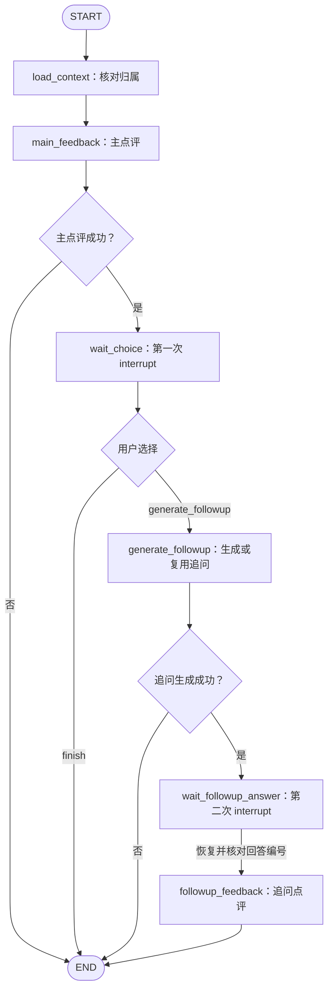
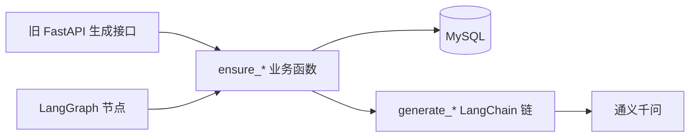
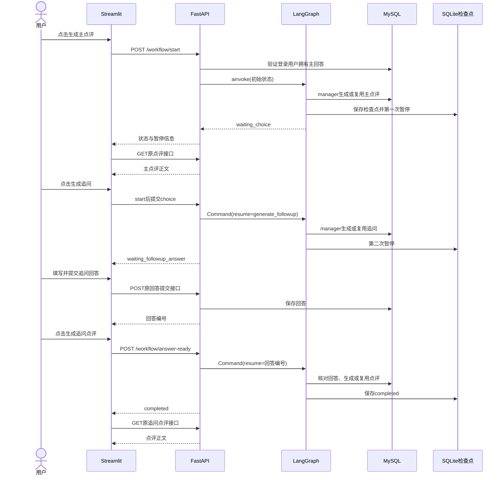

# LangGraph 工作流构建与数据流学习总结

整理日期：2026-11-09。依据本项目当前已保存代码编写。

这是一份配合源码阅读的教学笔记。学习目标不是背诵 LangGraph API，而是能够沿着一次按钮点击，解释请求进入哪里、数据存在哪里、哪个节点执行、为什么暂停、怎样恢复。

本文接续 [AI 单题点评总结](3AI单题点评模块代码与业务逻辑总结.md) 和 [针对性追问总结](4针对性追问模块代码与业务逻辑总结.md)。前两份报告记录的是当时的实现；其中“尚未接入 LangGraph”等说明属于历史阶段。本文描述当前接入后的组织方式，不重复旧模块所有建表语句和提示词。涉及旧函数和外键时，会解释本次用到的部分。

> 阅读顺序：先看第 1～5 节建立整体认识，再逐个阅读状态、图、节点，最后跟踪接口和前端。附录收录当前相关源码，方便对照；源码以后修改，本文不会自动更新。

## 1. 先说清楚：这次到底增加了什么

以前已经能生成主点评、追问和追问点评。这一阶段主要增加了这些步骤之间的组织方式：将它们放进有共享状态、有分支、有两次人工等待、有检查点的工作流。

业务仍然是：

```text
提交主回答
  → 生成主点评
  → 用户决定是否练习追问
  → 生成一道针对性追问
  → 用户提交追问回答
  → 生成追问点评
```

一张图处理的是“一条主回答对应的点评与追问流程”。一场练习有 3 道主问题时，可以有 3 条独立工作流。工作流 completed 不等于整场 InterviewSession completed；完成整场练习仍走原来的完成练习接口。

本次没有把整套项目重写成图，也没有让大模型决定所有业务步骤。当前图的路线由 Python 函数和固定连线决定，属于显式工作流；其中三个生成节点内部调用大模型。

## 2. 技术分别负责什么

| 技术或层 | 在项目中的任务 | 本次例子 |
|---|---|---|
| Streamlit | 页面展示、输入、按钮、请求 | 点击生成点评 |
| HTTP / httpx | 前端与后端传数据 | POST workflow/choice |
| FastAPI | 接收请求、验证登录、校验归属与阶段 | choose_interview_followup |
| Pydantic | 校验 HTTP 输入和模型结构化输出 | WorkflowChoice、FeedbackContent |
| LangGraph | 管理步骤、分支、共享状态与暂停恢复 | StateGraph、interrupt |
| manager 业务函数 | 查询与保存业务记录、复用成功结果 | ensure_followup |
| LangChain | 将提示词与结构化模型组合为生成链 | prompt \| structured_model |
| 通义千问 | 根据提示词生成具体内容 | 点评或追问正文 |
| SQLAlchemy AsyncSession | 在 Python 中操作 MySQL | 查询回答、提交点评状态 |
| MySQL | 保存业务事实 | 回答原文、追问、点评 JSON |
| SQLite checkpointer | 保存图的执行进度 | 状态、待执行节点、暂停信息 |

节点不必调用大模型。核对归属、等待选择都是节点。也不是每个 Python 函数都自动成为节点：要通过 add_node 注册，才能成为这张图的节点。

## 3. 本次文件地图

```text
backend/
├─ workflows/
│  ├─ __init__.py                       # 包入口，没有本阶段核心业务
│  ├─ interview_state.py                # 共享状态的字段结构
│  ├─ interview_nodes.py                # 六个业务节点、三个路线判断函数
│  └─ interview_graph.py                # 注册节点、连接路线、编译图
├─ schemas/
│  └─ interview_workflow.py             # 两种恢复请求的输入格式
├─ services/
│  ├─ interview_feedback_manager.py     # 主点评数据库业务
│  ├─ interview_followup_manager.py     # 追问数据库业务
│  ├─ interview_followup_feedback_manager.py # 追问点评数据库业务
│  ├─ interview_feedback.py             # 复用：主点评 LangChain 链
│  ├─ interview_followup.py             # 复用：追问 LangChain 链
│  └─ interview_followup_feedback.py    # 复用：追问点评 LangChain 链
├─ main.py                              # lifespan、三个工作流接口、旧接口转调 manager
├─ database.py                          # 复用：异步会话工厂和 get_db
├─ llm.py                               # 复用：通义千问客户端
└─ models/                              # 复用：原来的业务表模型

frontend/interview.py                   # 接入启动和恢复请求，继续查询原业务内容
runtime/interview_checkpoints.sqlite    # 运行时检查点文件，由组件维护
.gitignore                             # /runtime/ 不提交 Git
```

本次没有新增 MySQL 业务表模型。SQLite 内部检查点表由组件管理，不需要仿照业务表在 SQLTools 手动创建，也不要凭印象修改其中的数据。

## 4. 图的全貌：六个节点与三处分支



图中菱形对应路由函数，不是另行 add_node 的节点。当前源码注册了六个节点，路由函数有三个。

| 节点注册名 | 实际 Python 函数 | 业务任务 | 正常完成后的状态更新 |
|---|---|---|---|
| load_context | load_context | 核对用户、练习、主回答三者关系 | stage=main_feedback |
| main_feedback | main_feedback_node | 生成或复用主点评 | stage=waiting_choice |
| wait_choice | wait_choice_node | 第一次暂停，接收追问选择 | generating_followup 或 completed |
| generate_followup | generate_followup_node | 生成或复用追问 | followup_id、waiting_followup_answer |
| wait_followup_answer | wait_followup_answer_node | 第二次暂停，核对已保存回答 | followup_answer_id、followup_feedback |
| followup_feedback | followup_feedback_node | 生成或复用追问点评 | completed 或 failed |

END 表示这次图执行没有后续节点，不代表一定成功。失败分支也会到 END，需同时看 stage。

## 5. 四组概念必须分清

### 5.1 state 与 stage

state 是整个共享字典，stage 是其中的一个键。例如：

```python
{
    "user_id": 2,
    "session_id": 2,
    "answer_id": 4,
    "stage": "waiting_choice",
}
```

### 5.2 业务阶段与节点名称

waiting_choice 是业务阶段，wait_choice 是节点注册名。它们可以采用不同命名，但代码里的判断必须一致。

```python
return {"stage": "waiting_choice"}  # 更新数据
builder.add_edge("load_context", "main_feedback")  # 规定执行路线
```

单纯把 stage 改成某个字符串不会自动跳转。路线由 add_edge / add_conditional_edges 决定。

### 5.3 数据库 status 与图的 stage

InterviewFeedback.status 描述“一条点评是否生成成功”；InterviewState.stage 描述“一条工作流走到哪里”。前者 succeeded 后，后者可更新为 waiting_choice。

另有 FeedbackContent.can_evaluate：它描述输入是否足以做可靠评价。can_evaluate=false 仍可属于生成成功，代表模型按要求给出了“依据不足”的结构化结果。

### 5.4 业务快照与 LangGraph 检查点

题目快照保存在 MySQL 的 interview_questions，保存“本次练习抽到的题目版本”。配置快照保存创建练习时的设置。LangGraph 检查点保存“图运行到哪里、携带什么状态”。三者用途不同。

## 6. interview_state.py：定义流程携带的数据

核心结构：

```python
class InterviewState(TypedDict):
    user_id: int
    session_id: int
    answer_id: int
    followup_id: NotRequired[int]
    followup_answer_id: NotRequired[int]
    stage: NotRequired[Literal[...]]
```

| 字段 | 指向什么 | 何时有值 |
|---|---|---|
| user_id | users.id | 启动时，由后端登录身份提供 |
| session_id | interview_sessions.id | 启动时 |
| answer_id | interview_answers.id，主回答编号 | 启动时 |
| followup_id | interview_followups.id | 追问节点成功后 |
| followup_answer_id | interview_followup_answers.id | 第二次恢复且核对成功后 |
| stage | 业务阶段字符串 | 启动和各节点更新 |

TypedDict 帮编辑器理解字典字段，不是 Pydantic 的运行时校验。NotRequired 表示可以缺少这个键，不是自动赋值 None；Literal 列出类型层面允许的字符串，不会自动建立节点或连线。

当前源码 waiting_choice 后面的中文注释写成“等待用户回答追问”，容易误导；实际应理解为“等待用户决定是否生成追问”。真正等待回答的阶段是 waiting_followup_answer。本文只说明这一点，没有改动源代码。

节点返回部分更新。例如输入含 user_id、session_id、answer_id、stage，节点只返回：

```python
return {"stage": "waiting_choice"}
```

图会保留其他键，只替换 stage。本项目没有定义自定义 reducer，字段更新使用默认覆盖方式；它不是把整个字典替换成只剩一个键。[官方图 API 说明](https://docs.langchain.com/oss/python/langgraph/graph-api)

本项目选择主要传编号，而不把所有回答正文和 SQLAlchemy 对象塞进状态。需要正文时，manager 按编号查询 MySQL。这样检查点与 ORM 会话不绑定；但也意味着恢复后读取的是数据库保存的业务数据，不是把整个数据库一起冻结。

## 7. interview_graph.py：从普通函数组成可执行图

按源码顺序读：

```python
def build_interview_graph(checkpointer):
    builder = StateGraph(InterviewState)
```

build_interview_graph 是普通 Python 工厂函数，返回图对象。checkpointer 是调用者传入的保存器。StateGraph 是构建器，不是已经执行的流程。

```python
builder.add_node("main_feedback", main_feedback_node)
```

第一个参数是图中名称，第二个参数是函数对象。这里不加括号，因为是登记“以后执行哪个函数”，而非当场调用。

```python
builder.add_edge(START, "load_context")
builder.add_edge("load_context", "main_feedback")
```

固定连线意味着节点正常完成后，执行固定的下一步。抛出未处理异常时不会照常越过失败节点继续。

条件连线的实际例子：

```python
builder.add_conditional_edges(
    "main_feedback",
    route_after_main_feedback,
    {"wait_choice": "wait_choice", "end": END},
)
```

三部分分别是：从主点评节点出来；调用路由函数；将路由返回值映射到目标节点。字典左侧是路由标签，右侧是目标。这里名称碰巧一样，不代表概念相同。

主点评节点先返回更新，图应用更新后，路由函数读取新的 stage；成功走 wait_choice，其他正常返回结果走 END。

```python
return builder.compile(checkpointer=checkpointer)
```

compile 生成可调用的图并检查结构。它不执行归属查询、不调用模型、不直接启动一条用户流程。真正执行发生在 ainvoke。

当前文件不再在模块顶层创建全局图，也已删除临时命令行入口。原因是持久化图需要在 FastAPI 的异步生命周期内持有 SQLite 连接。不要再照早期教程导入模块级 interview_graph，应该导入 build_interview_graph。

## 8. interview_nodes.py：逐个拆解节点

### 8.1 load_context：先确定处理的是谁的回答

关键关联：

```python
InterviewAnswer.question_record_id == QuestionRecord.id
QuestionRecord.session_id == InterviewSession.id
```

方向是“主回答 → 练习题目快照 → 练习 → 所属用户”。QuestionRecord.id 是本次练习的题目记录编号，不是公共 questions.id。

三个 where 条件一起成立，才说明输入主回答属于指定练习且练习属于指定用户。db.scalar 只取符合条件的回答编号，查不到得到 None。

这个节点的名字叫 load_context，但实际只做存在性和关联校验，没有加载所有正文。成功返回 main_feedback，失败抛 ValueError。ValueError 不会自动变成 stage=failed。

### 8.2 main_feedback_node：图与业务函数之间的接口

```python
async with AsyncSessionLocal() as db:
    result = await ensure_main_feedback(
        db=db,
        answer_id=state["answer_id"],
        user_id=state["user_id"],
    )
```

节点自己创建数据库会话，因为普通节点函数不会自动执行 FastAPI 的 Depends。退出 async with 时释放会话；实际 commit 在 manager 中执行。

result 是 manager 返回的普通字典，不是共享 state。result.status=succeeded 时节点将 stage 更新为 waiting_choice；manager 正常返回 failed 时更新 failed。

### 8.3 wait_choice_node：第一次人工等待

```python
choice = interrupt({
    "message": "主点评已准备好，是否生成针对性追问？",
    "answer_id": state["answer_id"],
    "options": ["generate_followup", "finish"],
})
```

首次执行到这里，图保存暂停位置并把提示交给调用者。这个调用不会在服务器里一直等用户输入，也不会自己弹出浏览器按钮。当前 HTTP 请求可以返回，后续另一个请求恢复它。

外部执行 Command(resume="generate_followup") 后，choice 得到该字符串，节点返回 generating_followup。传 finish 则返回 completed。其他值抛异常。

恢复时会重新进入这个节点的函数开头；不是把整个 Python 调用栈原封不动保存在硬盘。interrupt 前的代码可能再次执行，因此这里没有在 interrupt 前请求模型或写业务记录。[官方 interrupt 说明](https://docs.langchain.com/oss/python/langgraph/interrupts)

不要用宽泛的 try/except 把 interrupt 包起来吞掉；它通过图运行时处理暂停控制流。

### 8.4 generate_followup_node：增加追问编号

调用 ensure_followup，成功返回 followup_id 和 waiting_followup_answer。追问文本由原有 LangChain 链生成，或复用数据库已有结果，不是从公共题库再抽一道。

图状态不保存 question_content；前端用原追问 GET 接口读取正文。生成失败正常返回 failed，路由直接结束。

### 8.5 wait_followup_answer_node：等待编号，不保存回答正文

```python
answer_id = interrupt({
    "message": "请提交追问回答，再用追问回答编号恢复流程",
    "followup_id": state["followup_id"],
})
```

本函数局部变量 answer_id 实际指“恢复时传进来的追问回答编号”；不要误认为 state["answer_id"] 那条主回答。它们只是不同作用域中同名。

恢复值必须是正整数。type(x) is int 还会拒绝布尔值，因为 Python 中 bool 是 int 的子类。随后查询 InterviewFollowupAnswer.id，并要求 followup_id 与当前追问一致。

通过后返回 followup_answer_id 和 followup_feedback。真正保存回答的仍是原提交接口。前端只需传后端返回的回答编号，用户不需要在页面手填。

即使数据库中已经存在追问回答，这个节点仍会先暂停；当前没有自动跳过等待的查询逻辑，前端负责提交已保存编号来继续。

### 8.6 followup_feedback_node：完成这一题的流程

调用 ensure_followup_feedback，输入是追问回答编号和用户编号。成功写 completed，正常失败写 failed，再到 END。不会再次生成追问，所以没有无限循环。

## 9. 三个 manager：为什么从 main.py 迁移

以前接口里同时包含权限检查、查重、模型调用和数据库提交。节点也要做同样的业务，如果复制整段代码，将来容易出现两套行为。

现在调用关系为：



manager 是本项目的命名，不是某个框架规定的特殊类。三个 manager 都使用普通 async 函数。

| 文件 | 核心函数 | 输入对象 | 额外业务条件 |
|---|---|---|---|
| interview_feedback_manager.py | ensure_main_feedback | 主回答 | 回答属于用户 |
| interview_followup_manager.py | ensure_followup | 主回答 | 首次生成追问前，主点评成功 |
| interview_followup_feedback_manager.py | ensure_followup_feedback | 追问回答 | 追问生成成功、正文及参考要点完整 |

共同步骤：

1. 沿外键核对归属，并用 with_for_update 锁住相关记录。
2. 已成功就直接返回；processing 则抛 HTTPException(409)。
3. 创建记录或复用失败记录，写 processing 和时间、模型信息。
4. 取出提示词要用的文本，commit 释放锁。
5. 调用模型；成功保存结构化内容，异常保存 failed 与简短说明。
6. 再 commit，返回业务结果字典。

为什么有两次 commit：第一次让其他请求知道任务已开始，并释放锁；第二次保存最终结果。代价是两个提交之间进程退出，会留下 processing，因此生命周期增加了遗留状态清理。

为什么节点检查过归属，manager 又检查：manager 也被旧接口独立调用，必须有自身的访问检查。重复查询是当前简单实现的取舍。

旧三个 POST 生成接口仍存在，函数体转调 ensure_*。没有把它们全部删除，也没有让它们自动经过 LangGraph。前端本次按钮已改走工作流接口，但单独调用旧 POST 仍可绕过图；业务表与检查点可能因此暂时不一致。

### 9.1 LangChain 在节点内部如何工作

三个 generate_* 服务继续使用提示词与结构化模型的组合。以主点评为例：

```python
chain = feedback_prompt | structured_model
result = await chain.ainvoke({
    "question": question,
    "reference_points": reference_points,
    "answer": answer,
})
```

输入字典填入提示词占位符；提示词产生消息；模型返回结果被解析成 FeedbackContent；manager 用 model_dump 转普通字典后保存 JSON。

追问链额外接收主点评文本，manager 用 json.dumps(..., ensure_ascii=False) 将点评字典转换为提示词中的文本。追问生成结果是 FollowupContent，含问题和参考要点；问题展示给用户，参考要点留在数据库供后续点评使用。

LangChain 的管道步骤不等于当前图注册的六个节点。这里一个 LangGraph 生成节点内部可以调用一整条 LangChain 链，两层组合各有职责。

## 10. 三个恢复动作与三个编号

用真实演示中的编号理解：

```text
user_id=2、session_id=2、answer_id=4
生成或复用后 followup_id=2
用户已保存的追问回答 followup_answer_id=1
```

这些数只是不同表的主键，数字相同也不意味着同一个对象。初始、两次暂停、结束的状态大致如下：

| 时刻 | 新增或变化字段 | 下一个动作 |
|---|---|---|
| 初始输入 | 三个必需编号、loading | 执行图 |
| 第一次暂停 | waiting_choice | 传选择字符串 |
| 第二次暂停 | followup_id=2、waiting_followup_answer | 保存回答、传回答编号 |
| 回答核对后 | followup_answer_id=1、followup_feedback | 执行点评节点 |
| 最终 | completed | 无后续节点 |

调用形式：

```python
# 首次执行：提供初始状态
await graph.ainvoke(initial_state, config=config)

# 第一次恢复：把字符串交给第一个 interrupt
await graph.ainvoke(Command(resume="generate_followup"), config=config)

# 第二次恢复：把整数交给第二个 interrupt
await graph.ainvoke(Command(resume=1), config=config)

# 节点异常后的继续执行，不是提交用户回答
await graph.ainvoke(None, config=config)
```

这些调用形式的适用条件由后端接口检查。用户选择不能随便发给等待回答的 interrupt；同一条图有两个暂停点，值的含义由当前暂停位置决定。

## 11. thread_id 与 checkpoint：重启后为什么能继续

接口统一构造：

```python
thread_id = f"user-{current_user.id}-session-{session_id}-answer-{answer_id}"
config = {"configurable": {"thread_id": thread_id}}
```

thread_id 是图检查点的索引，不是登录凭证，也不是 MySQL 会话对象。LangGraph 不会解析这个字符串替你验证权限；API 在读检查点之前先查询当前用户是否拥有回答。

同一图、同一保存文件、同一 thread_id 才能找到原进度。换编号会定位另一条流程。相同 thread_id 可以有一系列历史检查点，而非仅一个状态字符串。[官方持久化说明](https://docs.langchain.com/oss/python/langgraph/persistence)

aget_state(config) 是读取检查点，不执行节点。返回的 snapshot 常用字段：

| 表达式 | 本项目用途 |
|---|---|
| snapshot.values | 共享状态 |
| snapshot.next | 下一批待执行或恢复的节点名 |
| snapshot.tasks | 任务信息，包含错误或暂停对象 |
| task.interrupts | 当前任务的暂停提示 |
| task.error | 节点异常信息，供重试判断 |

接口从 task.interrupts 提取 id、value，转成普通字典返回给前端。命令行 ainvoke 直接返回里的 __interrupt__ 与接口返回里的 interrupts 是两种包装，不是两个不同的暂停机制。

SQLite 检查点位于 runtime/interview_checkpoints.sqlite。/runtime/ 已加入 .gitignore；它包含本机执行数据，源码仓库不携带它。丢失文件会丢失图进度，但不会直接删除 MySQL 中的业务回答和点评。

## 12. main.py 的 lifespan：资源何时打开和关闭

关键结构：

```python
@asynccontextmanager
async def lifespan(app: FastAPI):
    project_root = Path(__file__).resolve().parent.parent
    runtime_dir = project_root / "runtime"
    runtime_dir.mkdir(parents=True, exist_ok=True)

    async with AsyncSqliteSaver.from_conn_string(
        str(runtime_dir / "interview_checkpoints.sqlite")
    ) as checkpointer:
        app.state.interview_graph = build_interview_graph(checkpointer)
        # 当前源码这里还有 MySQL 遗留 processing 清理
        yield
```

Path(__file__) 从 main.py 位置推导项目根目录，避免当前终端路径变化导致创建多个检查点文件。async with 在服务运行期间保持连接有效，退出时关闭。SQLite 保存器负责其内部表结构。[官方保存器源码](https://github.com/langchain-ai/langgraph/blob/main/libs/checkpoint-sqlite/langgraph/checkpoint/sqlite/aio.py)

yield 前是启动准备；服务正常关闭时离开上下文，资源清理。强制杀进程不保证 Python 清理代码完整执行，但文件中已写入的检查点可供新进程读取。不要把正常资源关闭等同于对所有崩溃场景的事务保证。

```python
app = FastAPI(lifespan=lifespan)  # 此处省略项目原有 title 等配置
```

注册生命周期后，接口通过 request.app.state.interview_graph 获取图。这里的 app.state 是应用级共享对象容器，与图的 InterviewState 不是同一个东西。[FastAPI 生命周期说明](https://fastapi.tiangolo.com/advanced/events/)

## 13. schemas/interview_workflow.py：限制用户能传什么

```python
class WorkflowChoice(BaseModel):
    choice: Literal["generate_followup", "finish"]

class WorkflowAnswerReady(BaseModel):
    followup_answer_id: int = Field(gt=0, strict=True)
```

WorkflowChoice 拒绝其他选择值，返回 HTTP 422；WorkflowAnswerReady 要求严格正整数。schema 只能验证形状，不能验证数据库归属，也不能保证当前正暂停在正确节点，所以接口还要做查询和阶段判断。

用户不传 user_id；后端从 get_current_user 的登录结果获得它。Request 由 FastAPI 注入，不是 /docs 需要填写的请求体。

## 14. 三个工作流接口：分别对应什么操作

共同路径前缀为：

```text
/interview_sessions/{session_id}/answers/{answer_id}/workflow
```

| 后缀 | HTTP | 请求体 | 作用 |
|---|---|---|---|
| /start | POST | 无 | 首次启动、读取现有状态，或按条件重试 |
| /choice | POST | choice 字符串 | 恢复第一次暂停 |
| /answer-ready | POST | followup_answer_id 整数 | 恢复第二次暂停，继续点评 |

三个接口目前都在 /docs 的“AI追问”分组。/start 虽然可以返回现有状态，但也会触发首次生成或失败重试，所以是 POST，不应当作绝对只读的状态查询接口。

### 14.1 start_interview_workflow

先沿回答→快照→练习核对当前用户，再构造 thread_id，在锁内读检查点。

当前处理分为：没有状态则首次启动；stage=failed 且无后续节点则从入口重试；存在 task.error 则 ainvoke(None) 继续异常任务；其他情况只读现有进度。

执行后统一再读一次 snapshot，再组装响应。这个读取必须在 if/elif 外，否则第一次执行可能返回旧状态。

```python
if not snapshot.values or retry_failed:
    await interview_graph.ainvoke(initial_state, config=config)
elif retry_node_error:
    await interview_graph.ainvoke(None, config=config)

snapshot = await interview_graph.aget_state(config)
```

### 14.2 choose_interview_followup

再次检查归属，要求有检查点、stage=waiting_choice，且 task.name=wait_choice 的任务确实带有 interrupt。通过后传 Command(resume=data.choice)。

为什么要同时检查阶段与暂停任务：单有阶段字符串，不能证明图真的停在这个 interrupt。请求重复到达时，流程可能已经进入下一次等待，继续恢复会把字符串交错位置。

### 14.3 resume_after_followup_answer

要求 stage=waiting_followup_answer 且确实暂停在 wait_followup_answer。恢复前查询回答→追问，必须同时满足：回答编号存在、追问编号匹配检查点、追问 parent_answer_id 等于当前主回答。

通过后提交整数回答编号，等待节点再核对一遍，图自动进入追问点评。这个接口不保存回答正文。错编号返回 404，错阶段或没有检查点返回 409。

### 14.4 响应怎么看

```json
{
  "thread_id": "user-2-session-2-answer-4",
  "state": {"user_id": 2, "session_id": 2, "answer_id": 4, "stage": "waiting_choice"},
  "next_nodes": ["wait_choice"],
  "interrupts": [{"id": "示意标识", "value": {"message": "是否生成追问？"}}]
}
```

completed 且 next_nodes=[]、interrupts=[] 是正常结束。用之前已经完成的回答测试 /start，就不会重新出现暂停提示。成功返回 200 也不表示业务一定成功，应查看 state.stage；模型失败可能正常返回 failed。

## 15. 锁、事务与幂等：防止重复的三层措施

```python
lock = workflow_locks.setdefault(thread_id, asyncio.Lock())
async with lock:
    ...
```

setdefault 在字典中取已有锁，没有才保存新锁。同一工作流的三个接口共用这把锁，在本进程内排队；不同回答可分别执行。

它不等于数据库行锁：asyncio.Lock 管本进程中的工作流调用；with_for_update 管数据库事务中的业务记录；unique 约束是数据库层最终防线。各有范围，不能互相替代。

成功结果复用、提交 UUID 查重等措施降低重复保存和重复调用模型的概率。但 MySQL 和 SQLite 分属不同存储，没有一个覆盖两者的原子事务；当前不能声称“任何崩溃点都严格只执行一次”。模型返回后若进程尚未提交业务记录就退出，重试仍可能重复调用模型并增加费用。

## 16. 前端 interview.py：按钮怎样驱动图

### 16.1 参数从哪里一路传下来

```text
show_current_interview(session_id)
  → show_answer_feedback(主 answer_id, session_id)
    → show_answer_followup(主 answer_id, session_id)
      → show_followup_answer(data, session_id, main_answer_id)
        → show_answer_feedback(追问回答 id,
                               is_followup=True,
                               session_id,
                               main_answer_id)
```

同一个 show_answer_feedback 复用于主点评和追问点评，所以 answer_id 参数在两种模式下含义不同。main_answer_id 专门保留工作流所属主回答，防止构造错路径。

### 16.2 页面打开只查询，点击按钮才执行

主点评和追问点评正文继续走原来的 GET /.../feedback；追问正文继续走 GET /interview_answers/{主回答}/followup。

图状态主要保存编号和阶段，前端展示正文从 MySQL 查询，所以工作流响应看不到所有点评文字是正常的。

主点评按钮：POST /workflow/start，返回后 st.rerun，页面重跑再 GET 点评。st.rerun 是重跑 Streamlit 脚本，不是重新执行 LangGraph。

### 16.3 生成追问按钮

先 POST /start，兼容有主点评但没图进度的旧记录。若 waiting_choice，再 POST /choice；若已经 waiting_followup_answer，则重跑页面显示现有追问。其他阶段给出说明。

### 16.4 追问回答提交与点评按钮是两步

提交回答仍调用 POST /interview_followups/{followup_id}/answers，带 submission_id 和 content。保存成功后页面重跑，通过 GET 得到 saved_answer.id。

点击追问点评：POST /start；必要时 POST /choice，复用已有追问；确认 waiting_followup_answer 后 POST /answer-ready，传 saved_answer.id。图生成点评，页面再 GET 展示。

已有成功点评时直接展示，不会因为打开页面而主动运行图。这也意味着数据库已成功但检查点尚未推进的极端不一致情况，前端不一定自动修复。

当前代码 is_followup 分支仍给 generate_url=url 赋值，但追问点评实际走的是后面的工作流分支，不再用这个变量直接 POST 旧点评接口。不要仅看变量赋值就判断请求去向，要跟踪实际调用分支。

### 16.5 finish 分支当前在哪里

后端支持 choice=finish，图会 completed，整场练习状态不受影响。当前前端只有“生成一道追问”按钮，没有专门的“本题不再追问”按钮。因此用户不点击时，图会保留 waiting_choice；这是当前界面实现，不要在报告中误写成已提供该按钮。

## 17. 一次完整请求的数据流推演



图中省略了前端为了恢复旧记录而额外调用 start/choice 的细节。模型请求发生在 manager 调用 generate_* 时；成功复用分支没有模型请求。

## 18. 收尾的失败恢复代码：处理什么，不处理什么

### 18.1 业务生成失败

模型或解析异常被 manager 捕获，保存业务 status=failed，节点返回 stage=failed 并到 END。用户点击重试，start 从入口执行，成功的结果复用，失败的部分重新生成。

### 18.2 节点异常

HTTPException、数据库异常等可能使图未正常结束，并留下 task.error。start 检查到错误后，用 ainvoke(None) 继续未完成任务。它不是万能异常修复；数据库仍离线，重试仍失败；错误的恢复值若已记录，也不保证这样就能纠正。

### 18.3 启动时清理 processing

lifespan 在开放请求前，将三张生成表中的 processing 改 failed，说明上次服务退出中断了任务。这是“同一数据库只由一个本地后端实例处理任务”的假设。不能直接用于多进程或多服务部署，否则一个实例启动可能误伤另一个实例正在生成的记录。

### 18.4 当前恢复的边界

- 进程在节点中途直接崩溃，检查点可能有 next，却没有 task.error。当前 start 只处理首次、已结束的 failed 和显式 task.error，不覆盖所有无错误的遗留待执行任务。
- SQLite 与 MySQL 没有分布式事务；业务提交与图检查点提交之间可能存在短暂不一致。
- asyncio 锁是进程内的，workflow_locks 也未增加淘汰机制。
- 模型调用仍在 HTTP 请求期间等待，不是后台队列；浏览器超时不证明模型已经停止。
- 前端可在检查点丢失时根据业务记录重新走流程，所以“重启后页面还能看”本身不足以证明读取的是原检查点。
- 旧生成接口仍可绕过图。不要把现有设计描述成所有调用均已被图强制控制。
- 本报告记录实现与限制，不代表已完成故障注入、并发、多进程或每一种恢复场景测试。

这些是后续改进点，不需要为学习当前图而立即重写全部架构。

## 19. 怎样验证，以及本阶段已有的证据

已观察到的证据：命令行先后显示两次 __interrupt__，传选择字符串和回答编号后得到 completed；前端截图显示主点评、追问、回答与追问点评；/docs 对已有流程返回 completed，next_nodes 和 interrupts 为空。语法检查通过不能证明业务正确；对已完成记录的读取也不能代替首次启动验证。

尚未完整提供结果的项目：修正后新回答的首次启动响应、两处暂停 id 的重启前后对比、各类异常恢复和并发故障场景。

### 19.1 首次启动测试

新提交一道主回答，不点生成点评；SQL 查到 session_id、answer_id；用所属账号授权 /docs；调用 /workflow/start。第一次响应应有 waiting_choice 和暂停提示。如果是 completed，应换新回答，不要删旧检查点来掩盖测试数据选错的问题。

### 19.2 严格的重启恢复测试

记录第一次暂停 id → 重启后端 → 同一用户与编号调用 start → 对比阶段和 id → 提交 generate_followup → 记录第二次暂停 id → 再次重启 → 再比较 → 用已保存回答编号调用 answer-ready → completed。

### 19.3 前端操作测试

新提交回答 → 生成主点评 → 重启 → 生成追问 → 重启 → 提交追问回答 → 生成点评。它验证使用路径；若要区分“原检查点恢复”与“根据 MySQL 重建流程”，仍需检查 id。

只写“练习4题1答案”这种占位文本得到 can_evaluate=false 是正常输出。测试生成链是否成功，和评估模型能否判断答案正确性，是两个测试目标。

### 19.4 创建练习提示可用题目为 0

这发生在进入图之前。创建练习只选 approved、指定岗位、指定难度，并至少匹配一个所选知识点。draft 不可抽取；做过的题仍可再次安排。题库筛选失败不属于 LangGraph 暂停恢复故障。

## 20. 自测：不看代码能否解释这些问题

1. 为什么 stage=waiting_choice 不会自己让程序暂停？
2. 为什么注册函数时写 main_feedback_node 而不是 main_feedback_node()？
3. 为什么第二次恢复传整数，第一次恢复传字符串？
4. 为什么用户不能自己指定 user_id 后让后端信任它？
5. 为什么已经 completed 时 interrupts 为空？
6. 为什么数据库有追问回答，图却还可能等待它的编号？
7. 为什么一个节点重试不能声称模型绝不会被重复调用？
8. 为什么前端查到点评成功，不等于图检查点一定 completed？
9. 为什么 MySQL 的题目快照不能代替 LangGraph 检查点？
10. 为什么 lifespan 中的 yield 不能等同于工作流的 interrupt？

参考回答：暂停来自 interrupt；函数对象用于注册；恢复值由暂停点业务决定；身份来自 token 验证；结束无等待；当前等待节点没有自动检查现有回答；模型调用与两处存储提交不原子；业务与执行进度分开；快照保存题目版本而检查点保存执行位置；yield 管应用资源生命周期，interrupt 管图的人工等待。

## 21. 推荐回看源码的顺序

先看 interview_state.py 的字段，再看 interview_graph.py 的节点与连线；然后看 interview_nodes.py 中每个 return 和 interrupt；挑一个 ensure_* 理解数据库业务；再看 main.py 的三个接口如何分配初始调用和两次恢复；最后看 frontend/interview.py 按钮如何发起这些请求。

读代码时反复问三个问题：这个变量是从哪来的？它会更新到哪个地方？下一步执行由哪一行决定？能解释这三件事，就已经在理解数据流，而不只是认识 API 名称。

## 22. 进一步查阅

- [LangGraph 图 API](https://docs.langchain.com/oss/python/langgraph/graph-api)：状态、节点与连线。
- [暂停与恢复](https://docs.langchain.com/oss/python/langgraph/interrupts)：人工输入如何回到节点。
- [检查点持久化](https://docs.langchain.com/oss/python/langgraph/persistence)：thread 与状态保存。
- [异步 SQLite 保存器源码](https://github.com/langchain-ai/langgraph/blob/main/libs/checkpoint-sqlite/langgraph/checkpoint/sqlite/aio.py)：对应本项目采用的组件。
- [FastAPI lifespan](https://fastapi.tiangolo.com/advanced/events/)：共享资源生命周期。

以上链接解释框架概念；本文关于文件职责、接口路径和当前限制的结论以本项目源码为依据。

## 附录：当前相关源码

以下是报告生成时从工作区提取的代码。它们用于对照阅读，不需要重复复制到项目。前端附录较长，因为同一个函数同时处理主点评和追问点评；正文第 16 节可以帮助定位分支。


### A1. [backend/workflows/interview_state.py](../backend/workflows/interview_state.py)

```python
from typing import Literal,NotRequired,TypedDict


# 一道主问题的点评、追问流程所需的状态
class InterviewState(TypedDict):
  # 这条流程属于谁、哪次练习、哪条主回答
  user_id: int
  session_id: int
  answer_id: int

  # 尚未生成追问时，可以没有这些字段
  followup_id: NotRequired[int]
  followup_answer_id: NotRequired[int]

  # 当前业务阶段，由后端节点更新
  stage:NotRequired[Literal[
    "loading",     # 正在核对流程需要的数据
    "main_feedback",   # 准备进入主回答点评
    "waiting_choice",   # 等待用户回答追问
    "generating_followup",
    "waiting_followup_answer",
    "followup_feedback",
    "completed",   # 这道题的工作流完成
    "failed",
  ]]
```

### A2. [backend/workflows/interview_graph.py](../backend/workflows/interview_graph.py)

```python
from langgraph.graph import END,START,StateGraph
from backend.workflows.interview_nodes import (
    load_context,
    main_feedback_node,
    wait_choice_node,
    route_after_main_feedback,
    generate_followup_node,
    route_after_choice,
    wait_followup_answer_node,
    route_after_generate_followup,
    followup_feedback_node,
)
from backend.workflows.interview_state import InterviewState


def build_interview_graph(checkpointer):
    """创建并编译一道主问题的工作流"""

    # 指定这张图使用的是共享状态结构
    builder = StateGraph(InterviewState)
    builder.add_node("load_context",load_context)
    builder.add_node("main_feedback", main_feedback_node)
    builder.add_node("wait_choice", wait_choice_node)
    builder.add_node("generate_followup", generate_followup_node)
    builder.add_node("wait_followup_answer", wait_followup_answer_node)
    builder.add_node("followup_feedback", followup_feedback_node)

    builder.add_edge(START,"load_context")
    builder.add_edge("load_context", "main_feedback")
    builder.add_conditional_edges(
    "main_feedback",
    route_after_main_feedback,
    {
        "wait_choice": "wait_choice",
        "end": END,
    },
    )
    builder.add_conditional_edges(
    "wait_choice",
    route_after_choice,
    {
        "generate_followup": "generate_followup",
        "end": END,
    },
    )
    builder.add_conditional_edges(
    "generate_followup",
    route_after_generate_followup,
    {
        "wait_followup_answer": "wait_followup_answer",
        "end": END,
    },
    )
    builder.add_edge("wait_followup_answer", "followup_feedback")
    
    builder.add_edge("followup_feedback", END)
    
    

    # 编译图
    # 使用调用者传入的检查点保存器
    return builder.compile(checkpointer=checkpointer)
```

### A3. [backend/workflows/interview_nodes.py](../backend/workflows/interview_nodes.py)

```python
from sqlalchemy import select

from backend.database import AsyncSessionLocal
from backend.models.interview_answers import InterviewAnswer
from backend.models.interview_questions import QuestionRecord
from backend.models.interview_sessions import InterviewSession
from backend.workflows.interview_state import InterviewState
from backend.services.interview_feedback_manager import ensure_main_feedback
from langgraph.types import interrupt
from backend.services.interview_followup_manager import ensure_followup
from backend.models.interview_followup_answer import InterviewFollowupAnswer
from backend.services.interview_followup_feedback_manager import (
    ensure_followup_feedback,
)


async def load_context(state: InterviewState)->dict:
  # 核对主回答，练习和用户的关联关系

  # 节点自行获取数据库会话，用完后关闭
  async with AsyncSessionLocal() as db:
    answer_id = await db.scalar(
      select(InterviewAnswer.id)
      .join(
        QuestionRecord,
        InterviewAnswer.question_record_id == QuestionRecord.id
        )
        .join(
          InterviewSession,
          QuestionRecord.session_id == InterviewSession.id
        )
        .where(
          InterviewSession.user_id == state["user_id"],
          InterviewSession.id == state["session_id"],
          InterviewAnswer.id == state["answer_id"]
        )
      )
    if answer_id is None:
      raise ValueError("主回答不存在，或不属于指定用户和练习")

    # 返回需要更新的字段，其余状态由图保留
    return{"stage":"main_feedback"}
    


async def main_feedback_node(state: InterviewState)->dict:
  """生成或复用主回答点评，然后更新工作流阶段"""
  # 为本节点创建数据库会话
  async with AsyncSessionLocal() as db:
    result = await ensure_main_feedback(
      db = db,
      answer_id = state["answer_id"],
      user_id = state["user_id"],
    )
    # 点评业务函数会返回数据库中的点评状态
    if result["status"] == "succeeded":
      return {"stage":"waiting_choice"}
    
    return {"stage":"failed"}


def wait_choice_node(state: InterviewState)->dict:
  """暂停工作流，等待用户是否决定生成追问"""

  # 第一次允许到这里会暂停，将提示信息返回给调用者
  # 恢复时，外部传入的选择会成为choice的值
  choice = interrupt({
    "message":"主点评已准备好，是否生成针对性追问？",
    "answer_id":state["answer_id"],
    "options":["generate_followup","finish"]
  })
  # 恢复后才会执行下面的代码
  if choice == "generate_followup":
    return {"stage":"generating_followup"}
  elif choice == "finish":
    return {"stage":"completed"}
  else:
    raise ValueError("不支持的追问选择")


def route_after_main_feedback(state: InterviewState) -> str:
    """根据主点评结果，决定下一步去哪里。"""

    if state["stage"] == "waiting_choice":
        return "wait_choice"

    return "end"


async def generate_followup_node(state: InterviewState)->dict:
  """生成或复用追问，将追问编号写入工作流状态"""
  async with AsyncSessionLocal() as db:
    result = await ensure_followup(
      db = db,
      answer_id = state["answer_id"],
      user_id = state["user_id"],
    )
    if result["status"] == "succeeded":
      return {
        "stage":"waiting_followup_answer",
        "followup_id":result["followup_id"],
      }
    return {"stage":"failed"}


def route_after_choice(state: InterviewState) -> str:
    """根据用户选择，决定生成追问还是结束"""

    if state["stage"] == "generating_followup":
        return "generate_followup"

    return "end"


async def wait_followup_answer_node(state: InterviewState)->dict:
  """等待已保存的追问回答，并核对它属于当前追问"""

  # 暂停时不持有数据库会话：恢复值是已保存的回答编号
  answer_id = interrupt({
    "message":"请提交追问回答，再用追问回答编号恢复流程",
    "followup_id":state["followup_id"],
  })

  # 恢复值需要是正整数编号
  if type(answer_id) is not int or answer_id <= 0:
    raise ValueError("追问回答编号必须是正整数")

  async with AsyncSessionLocal() as db:
    saved_answer_id = await db.scalar(
      select(InterviewFollowupAnswer.id)
      .where(
        InterviewFollowupAnswer.id == answer_id,
        InterviewFollowupAnswer.followup_id == state["followup_id"],
      )
    )
    if saved_answer_id is None:
      raise ValueError("该追问回答不存在，或不属于当前追问")
    return {"stage":"followup_feedback","followup_answer_id":saved_answer_id}


def route_after_generate_followup(state: InterviewState) -> str:
    """追问生成成功才等待回答，失败则结束本次执行。"""

    if state["stage"] == "waiting_followup_answer":
        return "wait_followup_answer"

    return "end"


async def followup_feedback_node(state: InterviewState) -> dict:
    """生成或复用追问回答点评，更新最终业务阶段。"""

    async with AsyncSessionLocal() as db:
        result = await ensure_followup_feedback(
            db=db,
            followup_answer_id=state["followup_answer_id"],
            user_id=state["user_id"],
        )

    if result["status"] == "succeeded":
        return {"stage": "completed"}

    return {"stage": "failed"}
```

### A4. [backend/schemas/interview_workflow.py](../backend/schemas/interview_workflow.py)

```python
from typing import Literal

from pydantic import BaseModel, Field


class WorkflowChoice(BaseModel):
    # 只接受这两个选项，其他值由 FastAPI 返回 422
    choice: Literal["generate_followup", "finish"]


class WorkflowAnswerReady(BaseModel):
    # 必须是已经保存到数据库的追问回答编号
    followup_answer_id: int = Field(gt=0, strict=True)
```

### A5. [backend/services/interview_feedback_manager.py](../backend/services/interview_feedback_manager.py)

```python
import logging
import os
from datetime import datetime, timezone

from fastapi import HTTPException
from sqlalchemy import select
from sqlalchemy.ext.asyncio import AsyncSession

from backend.models.interview_answers import InterviewAnswer
from backend.models.interview_feedback import InterviewFeedback
from backend.models.interview_questions import QuestionRecord
from backend.models.interview_sessions import InterviewSession
from backend.services.interview_feedback import generate_feedback


logger = logging.getLogger("uvicorn.error")


# 处理点评业务：检查、复用、生成、保存点评	
async def ensure_main_feedback(
    db: AsyncSession,
    answer_id: int,
    user_id: int,
) -> dict:
    """复用已有点评，或生成并保存主回答的点评。"""
    # 查询回答和题目快照，并检查用户归属
    # 锁定记录，避免同一回答的两个生成请求同时创建点评
    result = await db.execute(
        select(InterviewAnswer,QuestionRecord)
        .join(QuestionRecord, InterviewAnswer.question_record_id == QuestionRecord.id)
        .join(InterviewSession, QuestionRecord.session_id == InterviewSession.id)
        .where(
            InterviewAnswer.id == answer_id,
            InterviewSession.user_id == user_id,
        ).with_for_update()
    )
    row = result.one_or_none()
    if row is None:
        raise HTTPException(status_code=404, detail="回答不存在")
    answer,question = row
    feedback = await db.scalar(
        select(InterviewFeedback)
        .where(InterviewFeedback.answer_id == answer_id)
        .with_for_update()
    )
    if feedback is not None:
        if feedback.status == "succeeded":
            # 已成功则使用保存的结果，不重复请求模型
            return{
                "answer_id": answer_id,
                "status": feedback.status,
                "feedback_content": feedback.feedback_content,
                "error_message": feedback.error_message,
            }
        if feedback.status == "processing":
            raise HTTPException(status_code=409, detail="点评正在生成中")
    # 2.创建或更新点评记录，先保存“处理中”
    now = datetime.now(timezone.utc).replace(tzinfo=None)
    if feedback is None:
        feedback = InterviewFeedback(
            answer_id=answer_id,
            created_at=now,
        )
        db.add(feedback)

    feedback.status = "processing"
    feedback.feedback_content = None
    feedback.error_message = None
    feedback.model_name = os.environ["LLM_MODEL"]
    feedback.updated_at = now

    # 先取出模型需要的文本，调用期间不再查询数据库
    question_text = question.content
    reference_text = question.reference_points
    answer_text = answer.content
    # 提交状态并释放锁，不在等待模型时一直锁住练习
    await db.commit()

    # 3.调用点评链：失败只影响点评，不影响已保存的回答
    try:
        content = await generate_feedback(question=question_text, reference_points=reference_text, answer=answer_text)
        # pydantic 对象转换成字典，保存到JSON字段
        feedback.feedback_content = content.model_dump()
        feedback.status = "succeeded"
    except Exception as exc:
        # 先记录回答编号和异常类型，不打印密钥或完整回答内容
        logger.error(
            "AI 点评失败：answer_id=%s，异常类型=%s",
            answer_id,
            type(exc).__name__,
        )

        feedback.error_message = "模型调用或结果解析失败，请稍后重试"
        feedback.status = "failed"
    # 4.保存最终结果
    feedback.updated_at = datetime.now(timezone.utc).replace(tzinfo=None)
    await db.commit()

    return {
        "answer_id": answer_id,
        "status": feedback.status,
        "feedback_content": feedback.feedback_content,
        "error_message": feedback.error_message,
    }
```

### A6. [backend/services/interview_followup_manager.py](../backend/services/interview_followup_manager.py)

```python
import json
import logging
import os
from datetime import datetime, timezone

from fastapi import HTTPException
from sqlalchemy import select
from sqlalchemy.ext.asyncio import AsyncSession

from backend.models.interview_answers import InterviewAnswer
from backend.models.interview_feedback import InterviewFeedback
from backend.models.interview_followup import InterviewFollowup
from backend.models.interview_questions import QuestionRecord
from backend.models.interview_sessions import InterviewSession
from backend.services.interview_followup import (
    FOLLOWUP_PROMPT_VERSION,
    generate_followup,
)


logger = logging.getLogger("uvicorn.error")


async def ensure_followup(
    db: AsyncSession,
    answer_id: int,
    user_id: int,
) -> dict:
    """复用已有追问，或根据主回答和主点评生成并保存追问。"""
    # 1.查询主回答和题目快照，检查用户归属并锁定
    result = await db.execute(
        select(InterviewAnswer,QuestionRecord)
        .join(QuestionRecord, InterviewAnswer.question_record_id == QuestionRecord.id)
        .join(InterviewSession, QuestionRecord.session_id == InterviewSession.id)
        .where(
            InterviewAnswer.id == answer_id,
            InterviewSession.user_id == user_id,
        ).with_for_update()
    )
    row = result.one_or_none()
    if row is None:
        raise HTTPException(status_code=404, detail="回答不存在")
    answer,question = row
    # 2. 已有成功追问直接复用，正在生成则拒绝重复请求
    followup = await db.scalar(
        select(InterviewFollowup)
        .where(
            InterviewFollowup.parent_answer_id == answer_id,
        ).with_for_update()
    )
    if followup is not None:
        if followup.status == "succeeded":
            # 成功后直接复用，不重复生成
            return {
                "parent_answer_id": answer_id,
                "followup_id": followup.id,
                "status": followup.status,
                "question_content": followup.question_content,
                "error_message": None,
            }

        if followup.status == "processing":
            raise HTTPException(
                status_code=409,
                detail="追问正在生成中，请稍后查询",
            )
    # 3.必须先有成功的主点评，才生成针对性追问
    feedback = await db.scalar(
        select(InterviewFeedback)
        .where(
            InterviewFeedback.answer_id == answer_id,
        ).with_for_update()
    )
    if feedback is None or feedback.status != "succeeded":
        raise HTTPException(status_code=400, detail="请先生成主点评，再生成追问")
    # 将点评JSON字典转换为提示词需要的文本
    feedback_text = json.dumps(feedback.feedback_content,ensure_ascii=False)
    question_text = question.content
    reference_text = question.reference_points
    answer_text = answer.content
    # 4. 新建记录或复用失败记录，先保存处理中状态
    now = datetime.now(timezone.utc).replace(tzinfo=None)
    if followup is None:
        followup = InterviewFollowup(
            parent_answer_id=answer_id,
            created_at=now,
        )
        db.add(followup)
    followup.status = "processing"
    followup.question_content = None
    followup.reference_points = None
    followup.error_message = None
    followup.model_name = os.environ["LLM_MODEL"]
    followup.prompt_version = FOLLOWUP_PROMPT_VERSION
    followup.updated_at = now
    # 释放锁后再等待模型，避免长时间锁住业务记录
    await db.commit()
    # 5.调用追问链，保存生成结果
    try:
        content = await generate_followup(
            question=question_text,
            reference_points=reference_text,
            answer=answer_text,
            feedback=feedback_text,
        )
        followup.question_content = content.question_content
        followup.reference_points = content.reference_points
        followup.status = "succeeded"
    except Exception as exc:
        logger.error(
            "AI 追问生成失败：answer_id=%s，异常类型=%s",
            answer_id,
            type(exc).__name__,
        )
        followup.status = "failed"
        followup.error_message = "追问生成失败，请稍后重试"
    followup.updated_at = datetime.now(timezone.utc).replace(tzinfo=None)
    await db.commit()
    # 参考要点只保存在数据库，不在这里返回给用户
    return {
        "parent_answer_id": answer_id,
        "followup_id": followup.id,
        "status": followup.status,
        "question_content": followup.question_content,
        "error_message": followup.error_message,
    }
```

### A7. [backend/services/interview_followup_feedback_manager.py](../backend/services/interview_followup_feedback_manager.py)

```python
import logging
import os
from datetime import datetime, timezone

from fastapi import HTTPException
from sqlalchemy import select
from sqlalchemy.ext.asyncio import AsyncSession

from backend.models.interview_answers import InterviewAnswer
from backend.models.interview_followup import InterviewFollowup
from backend.models.interview_followup_answer import InterviewFollowupAnswer
from backend.models.interview_followup_feedback import InterviewFollowupFeedback
from backend.models.interview_questions import QuestionRecord
from backend.models.interview_sessions import InterviewSession
from backend.services.interview_followup_feedback import (
    FOLLOWUP_FEEDBACK_PROMPT_VERSION,
    generate_followup_feedback,
)


logger = logging.getLogger("uvicorn.error")


async def ensure_followup_feedback(
    db: AsyncSession,
    followup_answer_id: int,
    user_id: int,
) -> dict:
    """复用已有点评，或生成并保存追问回答的点评。"""
    # 1. 同时查询追问回答和追问问题，并检查用户归属
    result = await db.execute(
        select(InterviewFollowupAnswer, InterviewFollowup)
        .join(
            InterviewFollowup,
            InterviewFollowupAnswer.followup_id == InterviewFollowup.id,
        )
        .join(
            InterviewAnswer,
            InterviewFollowup.parent_answer_id == InterviewAnswer.id,
        )
        .join(
            QuestionRecord,
            InterviewAnswer.question_record_id == QuestionRecord.id,
        )
        .join(
            InterviewSession,
            QuestionRecord.session_id == InterviewSession.id,
        )
        .where(
            InterviewFollowupAnswer.id == followup_answer_id,
            InterviewSession.user_id == user_id,
        )
        .with_for_update()
    )
    row = result.one_or_none()

    if row is None:
        raise HTTPException(status_code=404, detail="追问回答不存在")

    answer, followup = row

    # 2. 成功的点评直接复用，处理中则拒绝重复生成
    feedback = await db.scalar(
        select(InterviewFollowupFeedback)
        .where(
            InterviewFollowupFeedback.followup_answer_id == answer.id
        )
        .with_for_update()
    )

    if feedback is not None:
        if feedback.status == "succeeded":
            return {
                "followup_answer_id": answer.id,
                "status": feedback.status,
                "feedback_content": feedback.feedback_content,
                "error_message": None,
            }

        if feedback.status == "processing":
            raise HTTPException(
                status_code=409,
                detail="追问点评正在生成中，请稍后查询",
            )

    # 生成点评前，追问本身必须完整且生成成功
    if (
        followup.status != "succeeded"
        or not followup.question_content
        or not followup.reference_points
    ):
        raise HTTPException(
            status_code=409,
            detail="追问问题或参考要点不完整，暂时无法点评",
        )

    question_text = followup.question_content
    reference_text = followup.reference_points
    answer_text = answer.content

    # 3. 创建或复用记录，先提交处理中状态
    now = datetime.now(timezone.utc).replace(tzinfo=None)

    if feedback is None:
        feedback = InterviewFollowupFeedback(
            followup_answer_id=answer.id,
            created_at=now,
        )
        db.add(feedback)

    feedback.status = "processing"
    feedback.feedback_content = None
    feedback.error_message = None
    feedback.model_name = os.environ["LLM_MODEL"]
    feedback.prompt_version = FOLLOWUP_FEEDBACK_PROMPT_VERSION
    feedback.updated_at = now

    # 提交后释放锁，再等待模型
    await db.commit()

    # 4. 调用追问点评链
    try:
        content = await generate_followup_feedback(
            question=question_text,
            reference_points=reference_text,
            answer=answer_text,
        )

        feedback.feedback_content = content.model_dump()
        feedback.status = "succeeded"

    except Exception as exc:
        logger.error(
            "追问点评失败：followup_answer_id=%s，异常类型=%s",
            followup_answer_id,
            type(exc).__name__,
        )
        feedback.status = "failed"
        feedback.error_message = "追问点评生成失败，请稍后重试"

    # 5. 保存最终结果
    feedback.updated_at = datetime.now(timezone.utc).replace(tzinfo=None)
    await db.commit()

    return {
        "followup_answer_id": followup_answer_id,
        "status": feedback.status,
        "feedback_content": feedback.feedback_content,
        "error_message": feedback.error_message,
    }
```

### B. [backend/main.py](../backend/main.py) : `lifespan`

```python
@asynccontextmanager
async def lifespan(app: FastAPI):
    # 固定使用项目根目录，避免启动目录不同导致数据库文件位置变化
    project_root = Path(__file__).resolve().parent.parent
    runtime_dir = project_root / "runtime"
    runtime_dir.mkdir(parents=True, exist_ok=True)

    checkpoint_file = runtime_dir / "interview_checkpoints.sqlite"

    # 后端运行期间保持连接打开，关闭后端时自动释放
    async with AsyncSqliteSaver.from_conn_string(
        str(checkpoint_file)
    ) as checkpointer:
        # 将构建好的工作流保存在应用对象上
        app.state.interview_graph = build_interview_graph(checkpointer)
        # 单进程本地运行：上次退出时遗留的生成任务已无法继续
        now = datetime.now(timezone.utc).replace(tzinfo=None)

        async with AsyncSessionLocal() as db:
            # 三张表都有相同的状态、错误说明和更新时间字段
            for model in (
                InterviewFeedback,
                InterviewFollowup,
                InterviewFollowupFeedback,
            ):
                await db.execute(
                    update(model)
                    .where(model.status == "processing")
                    .values(
                        status="failed",
                        error_message="上次生成因服务退出而中断，请重试",
                        updated_at=now,
                    )
                )

            await db.commit()
        # 暂停生命周期初始化，让 FastAPI 开始接收请求
        yield
```

### B. [backend/main.py](../backend/main.py) : `generate_interview_feedback`

```python
@app.post(
    "/interview_answers/{answer_id}/feedback",
    tags=["AI点评"],
    summary="生成回答的点评",
)
async def generate_interview_feedback(
    answer_id: int,
    db: AsyncSession = Depends(get_db),
    current_user: User = Depends(get_current_user),
):
    # 接口负责获取登录用户和数据库会话，再交给业务函数处理
    return await ensure_main_feedback(
        db = db,
        answer_id = answer_id,
        user_id = current_user.id,
        )
```

### B. [backend/main.py](../backend/main.py) : `create_interview_followup`

```python
@app.post(
    "/interview_answers/{answer_id}/followup",
    tags=["AI追问"],
    summary="生成追问，失败时可重试",
)
async def create_interview_followup(
    answer_id: int,
    db: AsyncSession = Depends(get_db),
    current_user: User = Depends(get_current_user),
):
    # 接口提供登录用户和数据库会话，业务函数负责生成或复用追问
    return await ensure_followup(
        db=db,
        answer_id=answer_id,
        user_id=current_user.id,
    )
```

### B. [backend/main.py](../backend/main.py) : `create_followup_feedback`

```python
@app.post(
    "/interview_followup_answers/{followup_answer_id}/feedback",
    tags=["AI追问"],
    summary="生成追问回答的点评，失败时可重试",
)
async def create_followup_feedback(
    followup_answer_id: int,
    db: AsyncSession = Depends(get_db),
    current_user: User = Depends(get_current_user),
):
    # 接口提供回答编号、登录用户和数据库会话
    return await ensure_followup_feedback(
        db=db,
        followup_answer_id=followup_answer_id,
        user_id=current_user.id,

    )
```

### B. [backend/main.py](../backend/main.py) : `start_interview_workflow`

```python
@app.post(
    "/interview_sessions/{session_id}/answers/{answer_id}/workflow/start",
    tags=["AI追问"],
    summary="启动或读取一道主问题的工作流",
)
async def start_interview_workflow(
    session_id: int,
    answer_id: int,
    request: Request,
    db: AsyncSession = Depends(get_db),
    current_user: User = Depends(get_current_user),
):
    # 获取后端启动时创建的共享工作流
    interview_graph = request.app.state.interview_graph
    # 先检查回答、练习、当前用户的关联，避免读取别人的工作流
    owned_answer_id = await db.scalar(
        select(InterviewAnswer.id)
        .join(
            QuestionRecord,
            InterviewAnswer.question_record_id == QuestionRecord.id,
        )
        .join(
            InterviewSession,
            QuestionRecord.session_id == InterviewSession.id,
        )
        .where(
            InterviewAnswer.id == answer_id,
            InterviewSession.id == session_id,
            InterviewSession.user_id == current_user.id,
        )
    )
    # 未查到说明回答不存在，或不属于指定练习和当前用户
    if owned_answer_id is None:
        raise HTTPException(status_code=404, detail="回答不存在")
    # 使用后端验证的用户编号构造工作流编号
    thread_id = f"user-{current_user.id}-session-{session_id}-answer-{answer_id}"
    config = {
        "configurable": {
            "thread_id": thread_id,
        }
    }
    # 每个工作流使用自己的锁，不阻塞其他回答的启动
    lock = workflow_locks.setdefault(thread_id, asyncio.Lock())

    async with lock:
        # 读取当前进程保存的检查点
        snapshot = await interview_graph.aget_state(config)

        # 没有检查点时首次启动
        # 业务失败且本次执行已经结束时，允许从入口重新尝试
        retry_failed = (
            snapshot.values.get("stage") == "failed"
            and not snapshot.next
        )
        # 节点抛出异常时，检查点可能保留待执行节点和错误信息
        retry_node_error = any(
            task.error is not None
            for task in snapshot.tasks
        )

        if not snapshot.values or retry_failed:
            await interview_graph.ainvoke(
                {
                    "user_id": current_user.id,
                    "session_id": session_id,
                    "answer_id": answer_id,
                    "stage": "loading",
                },
                config=config,
            )
        elif retry_node_error:
            # 不传入新的初始状态，从检查点重试未完成的节点
            await interview_graph.ainvoke(
                None,
                config=config,
            )

        # 无论首次启动、失败重试，还是只查询，都读取最新检查点
        snapshot = await interview_graph.aget_state(config)

        # 将暂停对象转换为前端容易使用的普通字典
        interrupts = [
            {
                "id": item.id,
                "value": item.value,
            }
            for task in snapshot.tasks
            for item in task.interrupts
        ]

        return {
            "thread_id": thread_id,
            "state": snapshot.values,
            "next_nodes": list(snapshot.next),
            "interrupts": interrupts,
        }
```

### B. [backend/main.py](../backend/main.py) : `choose_interview_followup`

```python
@app.post(
    "/interview_sessions/{session_id}/answers/{answer_id}/workflow/choice",
    tags=["AI追问"],
    summary="提交选择并恢复工作流",
)
async def choose_interview_followup(
    session_id: int,
    answer_id: int,
    data: WorkflowChoice,
    request: Request,
    db: AsyncSession = Depends(get_db),
    current_user: User = Depends(get_current_user),
):
    # 获取后端启动时创建的共享工作流
    interview_graph = request.app.state.interview_graph
    # 每次请求都检查归属，不能仅凭工作流编号恢复
    owned_answer_id = await db.scalar(
        select(InterviewAnswer.id)
        .join(
            QuestionRecord,
            InterviewAnswer.question_record_id == QuestionRecord.id,
        )
        .join(
            InterviewSession,
            QuestionRecord.session_id == InterviewSession.id,
        )
        .where(
            InterviewAnswer.id == answer_id,
            InterviewSession.id == session_id,
            InterviewSession.user_id == current_user.id,
        )
    )

    if owned_answer_id is None:
        raise HTTPException(status_code=404, detail="回答不存在")

    # 与启动接口使用完全相同的编号规则
    thread_id = f"user-{current_user.id}-session-{session_id}-answer-{answer_id}"
    config = {"configurable": {"thread_id": thread_id}}
    lock = workflow_locks.setdefault(thread_id, asyncio.Lock())

    async with lock:
        snapshot = await interview_graph.aget_state(config)

        if not snapshot.values:
            raise HTTPException(
                status_code=409,
                detail="工作流未启动或进度已丢失，请先调用启动接口",
            )

        # 必须确实暂停在选择节点，避免把选择传给等待回答的节点
        waiting_choice = any(
            task.name == "wait_choice" and task.interrupts
            for task in snapshot.tasks
        )

        if (
            snapshot.values.get("stage") != "waiting_choice"
            or not waiting_choice
        ):
            raise HTTPException(
                status_code=409,
                detail="当前流程不在等待追问选择，请先查询工作流状态",
            )

        # 用户选择成为 wait_choice_node 中 interrupt() 的返回值
        await interview_graph.ainvoke(
            Command(resume=data.choice),
            config=config,
        )

        # 读取恢复后的最新状态及下一次暂停信息
        snapshot = await interview_graph.aget_state(config)

        interrupts = [
            {"id": item.id, "value": item.value}
            for task in snapshot.tasks
            for item in task.interrupts
        ]

        return {
            "thread_id": thread_id,
            "state": snapshot.values,
            "next_nodes": list(snapshot.next),
            "interrupts": interrupts,
        }
```

### B. [backend/main.py](../backend/main.py) : `resume_after_followup_answer`

```python
@app.post(
    "/interview_sessions/{session_id}/answers/{answer_id}/workflow/answer-ready",
    tags=["AI追问"],
    summary="确认追问回答已保存并恢复工作流",
)
async def resume_after_followup_answer(
    session_id: int,
    answer_id: int,
    data: WorkflowAnswerReady,
    request: Request,
    db: AsyncSession = Depends(get_db),
    current_user: User = Depends(get_current_user),
):
    # 获取后端启动时创建的共享工作流
    interview_graph = request.app.state.interview_graph
    # 先确认主回答属于指定练习和当前用户
    owned_answer_id = await db.scalar(
        select(InterviewAnswer.id)
        .join(
            QuestionRecord,
            InterviewAnswer.question_record_id == QuestionRecord.id,
        )
        .join(
            InterviewSession,
            QuestionRecord.session_id == InterviewSession.id,
        )
        .where(
            InterviewAnswer.id == answer_id,
            InterviewSession.id == session_id,
            InterviewSession.user_id == current_user.id,
        )
    )

    if owned_answer_id is None:
        raise HTTPException(status_code=404, detail="回答不存在")

    thread_id = f"user-{current_user.id}-session-{session_id}-answer-{answer_id}"
    config = {"configurable": {"thread_id": thread_id}}
    lock = workflow_locks.setdefault(thread_id, asyncio.Lock())

    async with lock:
        snapshot = await interview_graph.aget_state(config)

        if not snapshot.values:
            raise HTTPException(
                status_code=409,
                detail="工作流未启动或进度已丢失，请先调用启动接口",
            )

        # 确认当前暂停位置确实是在等待追问回答
        waiting_answer = any(
            task.name == "wait_followup_answer" and task.interrupts
            for task in snapshot.tasks
        )

        if (
            snapshot.values.get("stage") != "waiting_followup_answer"
            or not waiting_answer
        ):
            raise HTTPException(
                status_code=409,
                detail="当前流程不在等待追问回答",
            )

        # 在恢复前校验编号，避免错误输入进入工作流节点
        saved_answer_id = await db.scalar(
            select(InterviewFollowupAnswer.id)
            .join(
                InterviewFollowup,
                InterviewFollowupAnswer.followup_id == InterviewFollowup.id,
            )
            .where(
                InterviewFollowupAnswer.id == data.followup_answer_id,
                InterviewFollowup.id == snapshot.values["followup_id"],
                InterviewFollowup.parent_answer_id == answer_id,
            )
        )

        if saved_answer_id is None:
            raise HTTPException(
                status_code=404,
                detail="追问回答不存在，或不属于当前追问",
            )

        # 将回答编号交给等待节点，后续自动执行追问点评节点
        await interview_graph.ainvoke(
            Command(resume=saved_answer_id),
            config=config,
        )

        snapshot = await interview_graph.aget_state(config)

        interrupts = [
            {"id": item.id, "value": item.value}
            for task in snapshot.tasks
            for item in task.interrupts
        ]

        return {
            "thread_id": thread_id,
            "state": snapshot.values,
            "next_nodes": list(snapshot.next),
            "interrupts": interrupts,
        }
```

### B. [frontend/interview.py](../frontend/interview.py) : `show_answer_feedback`

```python
def show_answer_feedback(
    api_url,
    token,
    answer_id,
    is_followup=False,
    session_id=None,
    main_answer_id=None,
):
    if is_followup:
        st.subheader("追问回答点评")
        st.caption("这是巩固练习的点评，与首次主回答分开记录。")
        resource = "interview_followup_answers"
        key_prefix = "followup_feedback"
    else:
        st.subheader("AI 点评")
        resource = "interview_answers"
        key_prefix = "main_feedback"

    url = f"{api_url}/{resource}/{answer_id}/feedback"
    headers = {"Authorization": f"Bearer {token}"}

    # 查询仍使用原来的 GET 接口
    # 主点评的生成操作改由工作流启动接口负责
    if is_followup:
        generate_url = url
    else:
        generate_url = (
            f"{api_url}/interview_sessions/{session_id}"
            f"/answers/{answer_id}/workflow/start"
        )

    # 页面打开时只查询，不自动调用模型
    try:
        response = httpx.get(url, headers=headers, timeout=10.0)
    except httpx.RequestError:
        st.warning("暂时无法查询点评，请稍后重新打开。")
        return

    if response.status_code == 401:
        st.session_state.token = None
        st.rerun()

    if response.status_code != 200:
        st.error(f"查询点评失败：{response.status_code}")
        return

    data = response.json()
    status = data["status"]

    if status == "succeeded":
        content = data["feedback_content"]

        if not content["can_evaluate"]:
            st.warning("当前依据不足，无法可靠评价。")

        st.write(content["evaluation_note"])

        # 将 schema 的字段名对应到页面上的中文标题
        sections = {
            "strengths": "回答正确之处",
            "missing_points": "遗漏要点",
            "errors": "错误及解释",
            "suggestions": "改进建议",
        }
        # 不同栏目为空时，使用对应的说明
        if content["can_evaluate"]:
            empty_messages = {
                "strengths": "暂无可明确肯定的要点",
                "missing_points": "未发现需要补充的核心要点",
                "errors": "未发现明确错误",
                "suggestions": "暂无额外改进建议",
            }
        else:
            empty_messages = {
                "strengths": "依据不足，暂不判断",
                "missing_points": "依据不足，暂不判断",
                "errors": "依据不足，暂不判断",
                "suggestions": "请参考上方评价说明",
            }

        for field, title in sections.items():
            st.write(f"**{title}**")
            items = content[field]

            if not items:
                st.caption(empty_messages[field])
            else:
                for item in items:
                    st.write("•", item)
        # 主点评成功后显示追问，追问点评后不再继续追问
        if not is_followup:
            show_answer_followup(api_url, token, answer_id, session_id)

        return

    if status == "processing":
        st.info("点评正在生成中，请稍后刷新结果。")

        if st.button("刷新点评", key=f"refresh_{key_prefix}_{answer_id}"):
            st.rerun()

        return

    if status == "failed":
        st.warning(data["error_message"] or "点评生成失败")
        button_text = "重试点评"
    else:
        button_text = "生成点评"

    if st.button(button_text, key=f"generate_{key_prefix}_{answer_id}"):
        try:
            # 等待上限略长于后端模型客户端的 60 秒超时
            with st.spinner("正在生成点评，请稍候……"):
                if not is_followup:
                    # 主点评：启动工作流
                    response = httpx.post(
                        generate_url,
                        headers=headers,
                        timeout=90.0,
                    )
                else:
                    workflow_url = (
                        f"{api_url}/interview_sessions/{session_id}"
                        f"/answers/{main_answer_id}/workflow"
                    )

                    # 历史记录或后端重启后，可能没有内存检查点
                    response = httpx.post(
                        f"{workflow_url}/start",
                        headers=headers,
                        timeout=90.0,
                    )

                    if response.status_code == 200:
                        stage = response.json()["state"]["stage"]

                        # 已有追问回答，说明用户已选择过练习追问
                        # 恢复检查点时，复用数据库中已生成的追问
                        if stage == "waiting_choice":
                            response = httpx.post(
                                f"{workflow_url}/choice",
                                headers=headers,
                                json={"choice": "generate_followup"},
                                timeout=90.0,
                            )

                    if response.status_code == 200:
                        stage = response.json()["state"]["stage"]

                        if stage == "waiting_followup_answer":
                            # 回答已经通过原接口保存，这里只提交编号
                            response = httpx.post(
                                f"{workflow_url}/answer-ready",
                                headers=headers,
                                json={"followup_answer_id": answer_id},
                                timeout=90.0,
                            )
                        elif stage == "completed":
                            st.info("本题工作流已结束，请重新打开题目查询点评。")
                            return
                        else:
                            st.warning(
                                f"当前流程阶段为 {stage}，暂时无法生成追问点评。"
                            )
                            return
        except httpx.RequestError:
            st.warning(
                "暂时无法确认生成结果，请重新打开题目查询，"
                "不要立即认定生成失败。"
            )
            return

        if response.status_code == 200:
            # 成功或失败状态都从 GET 接口重新读取
            st.rerun()
        elif response.status_code == 401:
            st.session_state.token = None
            st.rerun()
        elif response.status_code in (400, 409):
            st.warning(response.json().get("detail", "请重新读取流程状态"))
        else:
            st.error(f"生成点评请求失败：{response.status_code}")
```

### B. [frontend/interview.py](../frontend/interview.py) : `show_answer_followup`

```python
def show_answer_followup(api_url, token, answer_id, session_id):
    st.subheader("针对性追问")
    st.caption("这是看过主点评后的巩固练习，每道主问题最多一次追问。")

    url = f"{api_url}/interview_answers/{answer_id}/followup"
    headers = {"Authorization": f"Bearer {token}"}

    # 打开页面只查询已有记录，不自动生成
    try:
        response = httpx.get(url, headers=headers, timeout=10.0)
    except httpx.RequestError:
        st.warning("暂时无法查询追问，请稍后重新打开。")
        return

    if response.status_code == 401:
        st.session_state.token = None
        st.rerun()

    if response.status_code != 200:
        st.error(f"查询追问失败：{response.status_code}")
        return

    data = response.json()
    status = data["status"]

    if status == "succeeded":
        st.write(data["question_content"])
        show_followup_answer(
            api_url, token, data, session_id, answer_id
        )
        return

    if status == "processing":
        st.info("追问正在生成中，请稍后刷新。")

        if st.button("刷新追问", key=f"refresh_followup_{answer_id}"):
            st.rerun()

        return

    if status == "failed":
        st.warning(data["error_message"] or "追问生成失败")
        button_text = "重试生成追问"
    else:
        button_text = "生成一道追问"

    if st.button(button_text, key=f"generate_followup_{answer_id}"):
        workflow_url = (
            f"{api_url}/interview_sessions/{session_id}"
            f"/answers/{answer_id}/workflow"
        )

        try:
            with st.spinner("正在准备追问……"):
                # 历史记录可能尚未启动工作流；已有进度时只读取
                response = httpx.post(
                    f"{workflow_url}/start",
                    headers=headers,
                    timeout=90.0,
                )

                if response.status_code == 401:
                    st.session_state.token = None
                    st.rerun()

                if response.status_code != 200:
                    st.warning(
                        response.json().get("detail", "无法启动工作流")
                    )
                    return

                stage = response.json()["state"]["stage"]

                if stage == "waiting_choice":
                    # 将按钮操作作为用户选择，恢复第一次暂停
                    response = httpx.post(
                        f"{workflow_url}/choice",
                        headers=headers,
                        json={"choice": "generate_followup"},
                        timeout=90.0,
                    )
                elif stage == "waiting_followup_answer":
                    # 追问已准备好，重新查询并展示数据库中的内容
                    st.rerun()
                else:
                    st.warning(f"当前流程阶段为 {stage}，暂时无法生成追问。")
                    return

        except httpx.RequestError:
            st.warning("无法确认生成结果，请重新打开题目查询。")
            return

        if response.status_code == 200:
            st.rerun()
        elif response.status_code == 401:
            st.session_state.token = None
            st.rerun()
        elif response.status_code in (400, 409):
            st.warning(response.json().get("detail", "请重新读取流程状态"))
        else:
            st.error(f"生成追问请求失败：{response.status_code}")
```

### B. [frontend/interview.py](../frontend/interview.py) : `show_followup_answer`

```python
def show_followup_answer(
    api_url, token, followup_data, session_id, main_answer_id
):
    # 已回答时显示数据库内容，不再允许编辑
    saved_answer = followup_data["followup_answer"]

    if saved_answer is not None:
        st.success("追问回答已保存")
        st.text(saved_answer["content"])
        show_answer_feedback(
            api_url,
            token,
            saved_answer["id"],  # 追问回答编号
            is_followup=True,
            session_id=session_id,
            main_answer_id=main_answer_id,
        )
        return

    followup_id = followup_data["followup_id"]

    # 每道追问使用独立状态，不与主回答混淆
    attempt_key = f"followup_attempt_{followup_id}"
    draft_key = f"followup_draft_{followup_id}"
    widget_key = f"followup_input_{followup_id}"

    if draft_key not in st.session_state:
        st.session_state[draft_key] = ""

    if attempt_key not in st.session_state:
        st.session_state[attempt_key] = {
            "submission_id": str(uuid4()),
            "pending_content": None,
        }

    # 复用已有的草稿保存回调
    content = st.text_area(
        "你的追问回答",
        value=st.session_state[draft_key],
        max_chars=1000,
        height=160,
        key=widget_key,
        on_change=save_answer_draft,
        args=(widget_key, draft_key),
    )

    if not st.button(
        "提交追问回答",
        key=f"submit_followup_{followup_id}",
    ):
        return

    if not content.strip():
        st.warning("请先填写追问回答")
        return

    # 内容相同时重试沿用原标识，内容变化则使用新标识
    attempt = st.session_state[attempt_key]
    if attempt["pending_content"] != content:
        attempt["submission_id"] = str(uuid4())
        attempt["pending_content"] = content

    try:
        response = httpx.post(
            f"{api_url}/interview_followups/{followup_id}/answers",
            headers={"Authorization": f"Bearer {token}"},
            json={
                "submission_id": attempt["submission_id"],
                "content": content,
            },
            timeout=10.0,
        )
    except httpx.RequestError:
        st.warning("无法确认提交结果，请重新打开题目查看是否已保存。")
        return

    if response.status_code == 200:
        # 重新查询追问，读取刚保存的回答
        st.rerun()
    elif response.status_code == 401:
        st.session_state.token = None
        st.rerun()
    elif response.status_code == 409:
        st.warning(response.json()["detail"])
        st.info("请重新打开题目，读取已保存的回答。")
    elif response.status_code == 422:
        st.error("回答不符合要求，请检查内容和长度。")
    else:
        st.error(f"提交追问回答失败：{response.status_code}")
```

